# Граф вызовов функций и передачи данных

Основной способ просмотра — [HTML с масштабированием и перемещением графа](Граф_вызовов.html). Markdown ниже содержит те же схемы и каталог исходников.

Версия `full50`, состояние исходников на 12 ноября 2026 года. Граф собран по текущему коду без запуска модели и проверок качества.

Это **граф вызовов**, а не порядок движения данных. Стрелка `A → B` означает, что A вызывает B. Например, `build_index()` вызывает и `extract_chunk()`, и `build_graph()`; прямого вызова между последними двумя нет.

Карточка функции показывает имя, назначение и путь файла внутри репозитория. Для вложенной функции также указан внешний контекст. Функции-обработчики `lambda` подписаны явно.

## Как читать связи

Небольшие блоки на стрелках — подписи с данными вызова. Они занимают собственное место в раскладке, а не накладываются на линии и карточки. Эти блоки не являются дополнительными функциями.

- **Сплошная стрелка** — прямой вызов функции, включая конструктор с собственным `__init__`. Условная ветка не означает, что вызов выполняется при каждом запуске.
- **Пунктир «выбранный режим», «callback» или «tools…»** — вызов через возвращённую функцию, переданный обработчик или словарь инструментов. Конкретная ветка определяется во время работы.
- **Пунктир «Pydantic»** — валидатор, который библиотека вызывает при проверке данных.
- **Пунктир «чтение свойства»** — выполнение getter свойства `Entity.node_id`.
- **Пунктир с HTTP-маршрутом** — запрос между процессом ассистента и процессом ERP; это не прямой Python-вызов.

- **Толстая стрелка** на двух схемах данных — передача данных. Цилиндрические блоки с пометкой «ДАННЫЕ» обозначают файлы, структуры или промежуточные результаты, а не функции.
- Подпись обычной стрелки перечисляет параметры интерфейса вызываемой функции и её возврат. Параметры с умолчаниями могут не передаваться явно. «Возврат» описывает результат B для A; это не дополнительный вызов A из B. Для функций без возвращаемого значения отдельно подписан эффект, например запись JSON. Для конструктора «создаёт» относится к результату вызова класса; сам `__init__` возвращает None.

Вызовы стандартной библиотеки, NetworkX, NumPy, HTTPX и внутренности Pydantic не развёрнуты. Конструкторы dataclass без собственной реализации также опущены. Это статическая карта возможных вызовов; выбор инструмента моделью и все варианты данных заранее не определяются. Тестовые функции и FakeLLM не входят в граф рабочего приложения.

CLI входит через `assistant.__main__`, который вызывает `infra.cli.main()`. FastAPI вызывает зарегистрированные `create_app.ask()` / `health()` при HTTP-запросе. `create_app()` регистрирует их, но не исполняет сразу. Та же особенность относится к middleware и маршрутам ERP.

Сначала изучай общую карту, затем нужный раздел. Повторение вершины в разных разделах означает ту же функцию, а не разные реализации.

## Содержание

- [Общая карта](#общая-карта)
- [Как пользоваться учебным просмотрщиком](#как-пользоваться-учебным-просмотрщиком)
- [Данные при подготовке базы](#данные-при-подготовке-базы)
- [Данные при ответе агента](#данные-при-ответе-агента)
- [1. Запуск, настройки и выбор режима](#1-запуск-настройки-и-выбор-режима)
- [2. Подготовка и сохранение базы знаний](#2-подготовка-и-сохранение-базы-знаний)
- [3. Извлечение сущностей и отношений](#3-извлечение-сущностей-и-отношений)
- [4. Построение общего графа](#4-построение-общего-графа)
- [5. Сообщества и сводки](#5-сообщества-и-сводки)
- [6. Локальный поиск](#6-локальный-поиск)
- [7. Глобальный поиск](#7-глобальный-поиск)
- [8. Общие проверки поиска](#8-общие-проверки-поиска)
- [9. Цикл агента и его проверки](#9-цикл-агента-и-его-проверки)
- [10. Инструменты агента](#10-инструменты-агента)
- [11. Проверка фактов и чисел ERP](#11-проверка-фактов-и-чисел-erp)
- [12. Клиент модели и кеш](#12-клиент-модели-и-кеш)
- [13. Обычный RAG и векторный поиск](#13-обычный-rag-и-векторный-поиск)
- [14. Оценка ответов и извлечения](#14-оценка-ответов-и-извлечения)
- [15. Клиент ERP и серверные обработчики](#15-клиент-erp-и-серверные-обработчики)
- [16. Нормализация и типы связей](#16-нормализация-и-типы-связей)
- [Почему проект устроен так](#почему-проект-устроен-так)
- [Каталог всех функций](#каталог-всех-функций)

## Общая карта

```mermaid
%%{init: {"htmlLabels": false, "flowchart": {"nodeSpacing": 65, "rankSpacing": 85, "padding": 24, "wrappingWidth": 340}}}%%
flowchart TB
    subgraph subsystem_entry["Запуск и оценка"]
        n097["`**cmd&#95;ask()**

Запускает ответ и печатает текст, источники и шаги

**Файл:** src/assistant/infra/cli.py`"]
        n098["`**cmd&#95;eval()**

Готовит вопросы и сохраняет оценку режима

**Файл:** src/assistant/infra/cli.py`"]
        n100["`**cmd&#95;eval&#95;extraction()**

Извлекает факты для сравнения с разметкой

**Файл:** src/assistant/infra/cli.py`"]
        n101["`**main()**

Разбирает команду и запускает нужное действие

**Файл:** src/assistant/infra/cli.py`"]
        n102["`**make&#95;context()**

Создаёт настройки и клиентов LLM и ERP

**Файл:** src/assistant/infra/cli.py`"]
        n103["`**runner()**

Создаёт обработчик вопроса для выбранного режима

**Файл:** src/assistant/infra/cli.py`"]
        call0["`Вход: mode, context, confirm
Возврат: функция вопрос → Outcome`"]
        call3["`Когда: Команда ask
Вход: args, context
Результат: текст в терминале`"]
        call4["`Когда: Команда eval
Вход: args, context
Результат: eval JSON на диске`"]
        call5["`Когда: Команда eval-extraction
Вход: args, context
Результат: метрики извлечения на диске`"]
        call6["`Когда: Если Context ещё не передан
Вход: нет
Возврат: Context`"]
    end
    style subsystem_entry fill:transparent,stroke:#8192a8,stroke-dasharray:5 4
    subgraph subsystem_preparation["Подготовка базы знаний"]
        n092["`**load&#95;chunks()**

Читает документы и получает все фрагменты

**Файл:** src/assistant/infra/chunking.py`"]
        n094["`**kb()**

Лениво загружает граф и сводки с диска

**Файл:** src/assistant/infra/cli.py`"]
        n137["`**build&#95;index()**

Управляет извлечением, графом и сводками

**Файл:** src/assistant/infra/indexing.py`"]
        n139["`**save&#95;kb()**

Подготавливает граф и сообщества для записи

**Файл:** src/assistant/infra/indexing.py`"]
        call16["`Вход: corpus&#95;dir, max&#95;chars
Возврат: list[Chunk]`"]
        call17["`Вход: kb, settings
Результат: graph и communities JSON`"]
    end
    style subsystem_preparation fill:transparent,stroke:#8192a8,stroke-dasharray:5 4
    subgraph subsystem_extraction["Извлечение фактов"]
        n057["`**extract&#95;chunk()**

Извлекает факты через LLM и фильтрует ошибки

**Файл:** src/assistant/graphrag/extraction.py`"]
    end
    style subsystem_extraction fill:transparent,stroke:#8192a8,stroke-dasharray:5 4
    subgraph subsystem_graph["Граф знаний"]
        n059["`**build&#95;graph()**

Объединяет факты, источники и встречные замены

**Файл:** src/assistant/graphrag/graph&#95;builder.py`"]
    end
    style subsystem_graph fill:transparent,stroke:#8192a8,stroke-dasharray:5 4
    subgraph subsystem_communities["Сообщества и сводки"]
        n048["`**detect&#95;communities()**

Делит граф алгоритмом Louvain с seed 7

**Файл:** src/assistant/graphrag/communities.py`"]
        n049["`**summarize&#95;community()**

Считает статистику и просит модель выбрать факты

**Файл:** src/assistant/graphrag/communities.py`"]
    end
    style subsystem_communities fill:transparent,stroke:#8192a8,stroke-dasharray:5 4
    subgraph subsystem_search["Поиск и обоснование ответа"]
        n085["`**global&#95;search()**

Выполняет map по сводкам и reduce общего ответа

**Файл:** src/assistant/graphrag/search.py`"]
        n086["`**local&#95;search()**

Отбирает пути графа и проверяет точечный ответ

**Файл:** src/assistant/graphrag/search.py`"]
        n106["`**lambda&#95;search()**

Отвечает выбранным поиском и создаёт Outcome

**Файл:** src/assistant/infra/cli.py
**Вложена в:** runner()`"]
        call10["`Когда: Режим global
mode global
Вход: question, kb, llm
Возврат: Answer`"]
        call11["`Когда: Режим local
mode local
Вход: question, kb, llm
Возврат: Answer`"]
    end
    style subsystem_search fill:transparent,stroke:#8192a8,stroke-dasharray:5 4
    subgraph subsystem_agent["Агент и проверка действий"]
        n011["`**run&#95;agent()**

Ведёт диалог, проверяет и выполняет инструменты

**Файл:** src/assistant/agent/agent.py`"]
        n104["`**ask&#95;agent()**

Запускает агента и приводит ответ к Outcome

**Файл:** src/assistant/infra/cli.py
**Вложена в:** runner()`"]
        call9["`Вход: question, llm, tools, max&#95;steps, confirm
Возврат: AgentResult`"]
    end
    style subsystem_agent fill:transparent,stroke:#8192a8,stroke-dasharray:5 4
    call1["`Когда: Режим agent
выбранный режим
Вход: question
Возврат: Outcome`"]
    call2["`Когда: Режим local / global
выбранный режим
Вход: question
Возврат: Outcome`"]
    call7["`Когда: Команда index
Вход: settings, llm, log
Возврат: KnowledgeBase и файлы индекса`"]
    call8["`Когда: Режим local / global / agent
Вход: нет
Возврат: KnowledgeBase`"]
    call12["`Вход: graph
Возврат: list[Community]`"]
    call13["`Когда: Для каждого найденного сообщества
Вход: community, graph, llm
Возврат: текст сводки`"]
    call14["`Когда: Для каждого фрагмента документа
Вход: chunk, llm
Возврат: ExtractionResult`"]
    call15["`Вход: results
Возврат: nx.DiGraph`"]
    class call0 payload
    n097 --- call0 --> n103
    class call1 payload
    n097 -.- call1 -.-> n104
    class call2 payload
    n097 -.- call2 -.-> n106
    class call3 payload
    n101 --- call3 --> n097
    class call4 payload
    n101 --- call4 --> n098
    class call5 payload
    n101 --- call5 --> n100
    class call6 payload
    n101 --- call6 --> n102
    class call7 payload
    n101 --- call7 --> n137
    class call8 payload
    n103 --- call8 --> n094
    class call9 payload
    n104 --- call9 --> n011
    class call10 payload
    n106 -.- call10 -.-> n085
    class call11 payload
    n106 -.- call11 -.-> n086
    class call12 payload
    n137 --- call12 --> n048
    class call13 payload
    n137 --- call13 --> n049
    class call14 payload
    n137 --- call14 --> n057
    class call15 payload
    n137 --- call15 --> n059
    class call16 payload
    n137 --- call16 --> n092
    class call17 payload
    n137 --- call17 --> n139
    classDef payload fill:transparent,stroke:#8090a5,stroke-dasharray:3 3,font-size:13px
```

На общей карте показаны главные входы. Ветвь baseline и подробные вызовы проверок, кеша и ERP развёрнуты ниже. Порядок выполнения независимых исходящих стрелок здесь не обозначен.

Пунктирная рамка с названием объединяет функции одной подсистемы по назначению. Это граница ответственности, а не шаг алгоритма или отдельный процесс. В одном файле могут быть функции разных подсистем; клиент ERP и сервис ERP разделены, потому что работают в разных процессах.

Строка **«Когда»** на ключевой связи описывает условие перехода. В HTML при выборе стрелки также видны точные условия веток и строки кода. Отсутствие такой строки не означает, что вызов выполняется всегда: до него ещё должно дойти управление.

## Как пользоваться учебным просмотрщиком

Открой [Граф_вызовов.html](Граф_вызовов.html). Основной экран — главные вызовы программы. Две соседние кнопки показывают движение данных при подготовке базы и при ответе агента.

Нажми на функцию: справа будет краткая справка, под графом — аргументы с источниками, действия, результат и пример. Кнопка **«Развернуть этот участок графа»** раскрывает выбранный участок с помощниками. На главную карту можно перейти кнопкой **«Главные вызовы»**. Отдельного списка всех подробных схем и учебных маршрутов нет.

При выборе блока посторонние участки графа приглушаются, оставаясь доступными для нажатия. В разборе функции есть настоящие выдержки из исходника с пояснениями; на стрелке — конкретная запись вызова и передача аргументов. Схема показывает код, а не запись реального запуска.

Общая карта намеренно показывает только главные функции. Все 156 функций доступны через поиск по имени, назначению или пути файла и через связанные вызовы. Подробные схемы — продолжение разбора выбранной функции.

Общие объяснения, обозначения и словарь находятся на отдельной странице: [Справка по проекту](Справка_по_проекту.html).

## Данные при подготовке базы

Координатор `build_index()` вызывает функции и передаёт между ними результаты. Поэтому стрелка данных от `extract_chunk()` к `build_graph()` через список результатов не означает прямого вызова одной функции из другой.

```mermaid
%%{init: {"htmlLabels": false, "flowchart": {"nodeSpacing": 65, "rankSpacing": 85, "padding": 24, "wrappingWidth": 340}}}%%
flowchart TB
    subgraph subsystem_preparation["Подготовка базы знаний"]
        n092["`**load&#95;chunks()**

Читает документы и получает все фрагменты

**Файл:** src/assistant/infra/chunking.py`"]
        n139["`**save&#95;kb()**

Подготавливает граф и сообщества для записи

**Файл:** src/assistant/infra/indexing.py`"]
        d_corpus[("`ДАННЫЕ
data/corpus: 80 Markdown-документов`")]
        d_chunks[("`ДАННЫЕ
list[Chunk]: chunk&#95;id, doc&#95;id, text; сохранённый индекс — 92 фрагмента`")]
        d_kb_files[("`ДАННЫЕ
ARTIFACTS&#95;DIR: graph.json и communities.json`")]
        flow0["`чтение текстов документов`"]
        flow1["`возвращает все фрагменты`"]
        flow13["`сериализация через indexing.&#95;dump`"]
    end
    style subsystem_preparation fill:transparent,stroke:#8192a8,stroke-dasharray:5 4
    subgraph subsystem_extraction["Извлечение фактов"]
        n057["`**extract&#95;chunk()**

Извлекает факты через LLM и фильтрует ошибки

**Файл:** src/assistant/graphrag/extraction.py`"]
        d_results[("`ДАННЫЕ
list[ExtractionResult]: entities, relations, dropped, источники`")]
        flow3["`добавляется ExtractionResult каждого фрагмента`"]
    end
    style subsystem_extraction fill:transparent,stroke:#8192a8,stroke-dasharray:5 4
    subgraph subsystem_graph["Граф знаний"]
        n059["`**build&#95;graph()**

Объединяет факты, источники и встречные замены

**Файл:** src/assistant/graphrag/graph&#95;builder.py`"]
        d_graph[("`ДАННЫЕ
nx.DiGraph: вершины, типы рёбер, weight, sources`")]
        flow5["`объединённый граф с источниками`"]
    end
    style subsystem_graph fill:transparent,stroke:#8192a8,stroke-dasharray:5 4
    subgraph subsystem_communities["Сообщества и сводки"]
        n048["`**detect&#95;communities()**

Делит граф алгоритмом Louvain с seed 7

**Файл:** src/assistant/graphrag/communities.py`"]
        n049["`**summarize&#95;community()**

Считает статистику и просит модель выбрать факты

**Файл:** src/assistant/graphrag/communities.py`"]
        d_communities[("`ДАННЫЕ
list[Community]: community&#95;id, nodes`")]
        d_summaries[("`ДАННЫЕ
Community.summary: проверенный текст до 150 слов`")]
        flow7["`список групп вершин`"]
        flow8["`по одному Community`"]
        flow10["`summary записывается в Community координатором`"]
    end
    style subsystem_communities fill:transparent,stroke:#8192a8,stroke-dasharray:5 4
    flow2["`по одному Chunk`"]
    flow4["`все результаты извлечения`"]
    flow6["`graph`"]
    flow9["`связи и веса для фактов и статистики`"]
    flow11["`graph внутри KnowledgeBase`"]
    flow12["`сообщества со сводками внутри KnowledgeBase`"]
    class flow0 payload
    d_corpus --- flow0 ==> n092
    class flow1 payload
    n092 --- flow1 ==> d_chunks
    class flow2 payload
    d_chunks --- flow2 ==> n057
    class flow3 payload
    n057 --- flow3 ==> d_results
    class flow4 payload
    d_results --- flow4 ==> n059
    class flow5 payload
    n059 --- flow5 ==> d_graph
    class flow6 payload
    d_graph --- flow6 ==> n048
    class flow7 payload
    n048 --- flow7 ==> d_communities
    class flow8 payload
    d_communities --- flow8 ==> n049
    class flow9 payload
    d_graph --- flow9 ==> n049
    class flow10 payload
    n049 --- flow10 ==> d_summaries
    class flow11 payload
    d_graph --- flow11 ==> n139
    class flow12 payload
    d_summaries --- flow12 ==> n139
    class flow13 payload
    n139 --- flow13 ==> d_kb_files
    classDef payload fill:transparent,stroke:#8090a5,stroke-dasharray:3 3,font-size:13px
```

## Данные при ответе агента

Схема показывает режим agent. В режимах local/global выбранный поиск вызывается напрямую через обработчик runner; цикла агента и обращений в ERP нет. Клиент модели передаётся инструментам при создании и повторно используется. Обратные потоки результатов в агент показаны явно.

```mermaid
%%{init: {"htmlLabels": false, "flowchart": {"nodeSpacing": 65, "rankSpacing": 85, "padding": 24, "wrappingWidth": 340}}}%%
flowchart TB
    subgraph subsystem_entry["Запуск и оценка"]
        a_question[("`ДАННЫЕ
Вопрос пользователя: question; режим mode; разрешение confirm`")]
    end
    style subsystem_entry fill:transparent,stroke:#8192a8,stroke-dasharray:5 4
    subgraph subsystem_preparation["Подготовка базы знаний"]
        n138["`**load&#95;kb()**

Восстанавливает базу знаний из JSON

**Файл:** src/assistant/infra/indexing.py`"]
        a_files[("`ДАННЫЕ
graph.json, communities.json и vocabulary.json`")]
        a_kb[("`ДАННЫЕ
KnowledgeBase: graph, communities, vocabulary`")]
        flow0["`чтение сохранённой базы`"]
        flow1["`восстановленный KnowledgeBase`"]
    end
    style subsystem_preparation fill:transparent,stroke:#8192a8,stroke-dasharray:5 4
    subgraph subsystem_search["Поиск и обоснование ответа"]
        n086["`**local&#95;search()**

Отбирает пути графа и проверяет точечный ответ

**Файл:** src/assistant/graphrag/search.py`"]
        n085["`**global&#95;search()**

Выполняет map по сводкам и reduce общего ответа

**Файл:** src/assistant/graphrag/search.py`"]
        a_search[("`ДАННЫЕ
Локальный: answer, facts, sources, refused; глобальный: answer, sources, refused`")]
        flow10["`Answer преобразуется обёрткой в словарь`"]
        flow11["`Answer преобразуется обёрткой в словарь`"]
    end
    style subsystem_search fill:transparent,stroke:#8192a8,stroke-dasharray:5 4
    subgraph subsystem_agent["Агент и проверка действий"]
        n016["`**build&#95;tools()**

Создаёт словарь пяти проверяемых инструментов

**Файл:** src/assistant/agent/tools.py`"]
        n011["`**run&#95;agent()**

Ведёт диалог, проверяет и выполняет инструменты

**Файл:** src/assistant/agent/agent.py`"]
        n020["`**checked()**

Проверяет аргументы и выполняет инструмент

**Файл:** src/assistant/agent/tools.py
**Вложена в:** build&#95;tools.wrap()`"]
        a_tools[("`ДАННЫЕ
tools: имя инструмента → проверяемая функция`")]
        a_calls[("`ДАННЫЕ
ToolCall: name и arguments; решение предлагает Qwen`")]
        a_answer[("`ДАННЫЕ
AgentResult: answer, sources, steps, refused, needs&#95;confirmation, pending&#95;action`")]
        flow3["`словарь инструментов`"]
        flow5["`tools`"]
        flow6["`LLMResponse.tool&#95;calls из llm.chat`"]
        flow7["`проверенные arguments выбранного инструмента`"]
        flow20["`итог; при confirm=False заказ остаётся pending&#95;action`"]
    end
    style subsystem_agent fill:transparent,stroke:#8192a8,stroke-dasharray:5 4
    subgraph subsystem_erp_client["Клиент ERP в ассистенте"]
        n114["`**get&#95;price()**

Запрашивает цену и статус детали

**Файл:** src/assistant/infra/erp&#95;client.py`"]
        n115["`**get&#95;stock()**

Запрашивает остаток детали на складе

**Файл:** src/assistant/infra/erp&#95;client.py`"]
        n113["`**create&#95;order()**

Отправляет параметры заказа в ERP

**Файл:** src/assistant/infra/erp&#95;client.py`"]
        a_erp[("`ДАННЫЕ
ERP: part&#95;id и price&#95;rub; либо part&#95;id, warehouse и qty; либо order&#95;id`")]
        flow16["`JSON цены`"]
        flow17["`JSON остатка`"]
        flow18["`JSON созданного заказа`"]
    end
    style subsystem_erp_client fill:transparent,stroke:#8192a8,stroke-dasharray:5 4
    flow2["`kb; также передаются клиенты llm и erp`"]
    flow4["`question и confirm через обработчик runner`"]
    flow8["`для search&#95;knowledge: question, kb, llm через обёртку`"]
    flow9["`для summarize&#95;topic: question, kb, llm через обёртку`"]
    flow12["`результат сохраняется и передаётся модели`"]
    flow13["`для get&#95;price: part&#95;id`"]
    flow14["`для check&#95;stock: part&#95;id, warehouse`"]
    flow15["`для create&#95;service&#95;order: part&#95;id, warehouse, qty, model; только при confirm`"]
    flow19["`результат инструмента для ответа и проверки чисел`"]
    class flow0 payload
    a_files --- flow0 ==> n138
    class flow1 payload
    n138 --- flow1 ==> a_kb
    class flow2 payload
    a_kb --- flow2 ==> n016
    class flow3 payload
    n016 --- flow3 ==> a_tools
    class flow4 payload
    a_question --- flow4 ==> n011
    class flow5 payload
    a_tools --- flow5 ==> n011
    class flow6 payload
    n011 --- flow6 ==> a_calls
    class flow7 payload
    a_calls --- flow7 ==> n020
    class flow8 payload
    n020 --- flow8 ==> n086
    class flow9 payload
    n020 --- flow9 ==> n085
    class flow10 payload
    n086 --- flow10 ==> a_search
    class flow11 payload
    n085 --- flow11 ==> a_search
    class flow12 payload
    a_search --- flow12 ==> n011
    class flow13 payload
    n020 --- flow13 ==> n114
    class flow14 payload
    n020 --- flow14 ==> n115
    class flow15 payload
    n020 --- flow15 ==> n113
    class flow16 payload
    n114 --- flow16 ==> a_erp
    class flow17 payload
    n115 --- flow17 ==> a_erp
    class flow18 payload
    n113 --- flow18 ==> a_erp
    class flow19 payload
    a_erp --- flow19 ==> n011
    class flow20 payload
    n011 --- flow20 ==> a_answer
    classDef payload fill:transparent,stroke:#8090a5,stroke-dasharray:3 3,font-size:13px
```

**Что содержат основные структуры**

| Данные | Содержимое | Откуда появляются |
| --- | --- | --- |
| `Chunk` | `chunk_id`, `doc_id`, `text` | Разбиение исходного документа |
| `ExtractionResult` | `entities`, `relations`, `dropped`, идентификаторы источника | Извлечение и проверка одного фрагмента |
| `KnowledgeBase` | `graph`, `communities`, `vocabulary` | Построение или загрузка базы знаний |
| `Answer` | `text`, `sources`, `facts`, `refused` | Локальный или глобальный поиск |
| `LLMResponse` | `content`, `tool_calls`, счётчики токенов | API модели либо дисковый кеш |
| `ToolCall` | `id`, `name`, `arguments` | Предложение инструмента моделью |
| `AgentResult` | `answer`, `steps`, `sources`, `refused`, подтверждение и отложенное действие | Работа агента |
| `Outcome` | Общий текст, источники, шаги и подтверждение | Адаптация разных режимов для CLI/API и оценки |

У всех этих структур поля заданы в исходниках. Отдельные поля могут быть пустыми; например, обёртка глобального поиска сейчас не передаёт поле facts агенту.

## 1. Запуск, настройки и выбор режима

```mermaid
%%{init: {"htmlLabels": false, "flowchart": {"nodeSpacing": 65, "rankSpacing": 85, "padding": 24, "wrappingWidth": 340}}}%%
flowchart TB
    subgraph subsystem_entry["Запуск и оценка"]
        n088["`**create&#95;app()**

Создаёт API ассистента и регистрирует маршруты

**Файл:** src/assistant/infra/api.py`"]
        n089["`**ask()**

Принимает HTTP-вопрос и вызывает выбранный режим

**Файл:** src/assistant/infra/api.py
**Вложена в:** create&#95;app()`"]
        n090["`**health()**

Возвращает признак доступности API

**Файл:** src/assistant/infra/api.py
**Вложена в:** create&#95;app()`"]
        n095["`**&#95;dump()**

Сохраняет JSON с результатами оценки

**Файл:** src/assistant/infra/cli.py`"]
        n096["`**&#95;from&#95;answer()**

Приводит ответ поиска к общему виду Outcome

**Файл:** src/assistant/infra/cli.py`"]
        n097["`**cmd&#95;ask()**

Запускает ответ и печатает текст, источники и шаги

**Файл:** src/assistant/infra/cli.py`"]
        n098["`**cmd&#95;eval()**

Готовит вопросы и сохраняет оценку режима

**Файл:** src/assistant/infra/cli.py`"]
        n099["`**lambda&#95;run()**

Передаёт текст очередного вопроса обработчику

**Файл:** src/assistant/infra/cli.py
**Вложена в:** cmd&#95;eval()`"]
        n100["`**cmd&#95;eval&#95;extraction()**

Извлекает факты для сравнения с разметкой

**Файл:** src/assistant/infra/cli.py`"]
        n101["`**main()**

Разбирает команду и запускает нужное действие

**Файл:** src/assistant/infra/cli.py`"]
        n102["`**make&#95;context()**

Создаёт настройки и клиентов LLM и ERP

**Файл:** src/assistant/infra/cli.py`"]
        n103["`**runner()**

Создаёт обработчик вопроса для выбранного режима

**Файл:** src/assistant/infra/cli.py`"]
        n123["`**evaluate()**

Запускает вопросы и собирает метрики и трассы

**Файл:** src/assistant/infra/evaluation.py`"]
        n124["`**evaluate&#95;extraction()**

Сравнивает извлечение с разметкой документов

**Файл:** src/assistant/infra/evaluation.py`"]
        call0["`Вход: нет
Возврат: Context`"]
        call1["`Вход: mode, context, confirm
Возврат: функция вопрос → Outcome`"]
        call8["`Вход: mode, context, confirm
Возврат: функция вопрос → Outcome`"]
        call12["`Вход: path, data
Результат: JSON на диске`"]
        call13["`Вход: mode, context, confirm
Возврат: функция вопрос → Outcome`"]
        call14["`Вход: questions, run, known&#95;codes, stats
Возврат: summary и rows`"]
        call21["`Вход: path, data
Результат: JSON на диске`"]
        call22["`Вход: gold, results
Возврат: метрики сущностей и связей`"]
        call23["`Когда: Команда ask
Вход: args, context
Результат: текст в терминале`"]
        call24["`Когда: Команда eval
Вход: args, context
Результат: eval JSON на диске`"]
        call25["`Когда: Команда eval-extraction
Вход: args, context
Результат: метрики извлечения на диске`"]
        call26["`Когда: Если Context ещё не передан
Вход: нет
Возврат: Context`"]
    end
    style subsystem_entry fill:transparent,stroke:#8192a8,stroke-dasharray:5 4
    subgraph subsystem_preparation["Подготовка базы знаний"]
        n092["`**load&#95;chunks()**

Читает документы и получает все фрагменты

**Файл:** src/assistant/infra/chunking.py`"]
        n094["`**kb()**

Лениво загружает граф и сводки с диска

**Файл:** src/assistant/infra/cli.py`"]
        n137["`**build&#95;index()**

Управляет извлечением, графом и сводками

**Файл:** src/assistant/infra/indexing.py`"]
        n138["`**load&#95;kb()**

Восстанавливает базу знаний из JSON

**Файл:** src/assistant/infra/indexing.py`"]
        call7["`Когда: База ещё не загружена
Вход: settings
Возврат: KnowledgeBase`"]
    end
    style subsystem_preparation fill:transparent,stroke:#8192a8,stroke-dasharray:5 4
    subgraph subsystem_extraction["Извлечение фактов"]
        n057["`**extract&#95;chunk()**

Извлекает факты через LLM и фильтрует ошибки

**Файл:** src/assistant/graphrag/extraction.py`"]
    end
    style subsystem_extraction fill:transparent,stroke:#8192a8,stroke-dasharray:5 4
    subgraph subsystem_search["Поиск и обоснование ответа"]
        n085["`**global&#95;search()**

Выполняет map по сводкам и reduce общего ответа

**Файл:** src/assistant/graphrag/search.py`"]
        n086["`**local&#95;search()**

Отбирает пути графа и проверяет точечный ответ

**Файл:** src/assistant/graphrag/search.py`"]
        n093["`**flat()**

Лениво создаёт и запоминает обычный RAG

**Файл:** src/assistant/infra/cli.py`"]
        n105["`**lambda&#95;baseline()**

Отвечает через обычный RAG и создаёт Outcome

**Файл:** src/assistant/infra/cli.py
**Вложена в:** runner()`"]
        n106["`**lambda&#95;search()**

Отвечает выбранным поиском и создаёт Outcome

**Файл:** src/assistant/infra/cli.py
**Вложена в:** runner()`"]
        n127["`**&#95;&#95;init&#95;&#95;()**

Получает эмбеддинги фрагментов и строит индекс

**Файл:** src/assistant/infra/flat&#95;rag.py`"]
        n128["`**answer()**

Находит близкие фрагменты и просит LLM ответить

**Файл:** src/assistant/infra/flat&#95;rag.py`"]
        call6["`Когда: RAG ещё не создан
Вход: chunks, llm
Создаёт: FlatRag`"]
        call36["`Вход: question, top&#95;k
Возврат: Answer`"]
        call37["`Когда: Режим global
mode global
Вход: question, kb, llm
Возврат: Answer`"]
        call38["`Когда: Режим local
mode local
Вход: question, kb, llm
Возврат: Answer`"]
    end
    style subsystem_search fill:transparent,stroke:#8192a8,stroke-dasharray:5 4
    subgraph subsystem_agent["Агент и проверка действий"]
        n011["`**run&#95;agent()**

Ведёт диалог, проверяет и выполняет инструменты

**Файл:** src/assistant/agent/agent.py`"]
        n016["`**build&#95;tools()**

Создаёт словарь пяти проверяемых инструментов

**Файл:** src/assistant/agent/tools.py`"]
        n104["`**ask&#95;agent()**

Запускает агента и приводит ответ к Outcome

**Файл:** src/assistant/infra/cli.py
**Вложена в:** runner()`"]
        call34["`Вход: question, llm, tools, max&#95;steps, confirm
Возврат: AgentResult`"]
    end
    style subsystem_agent fill:transparent,stroke:#8192a8,stroke-dasharray:5 4
    subgraph subsystem_erp_client["Клиент ERP в ассистенте"]
        n111["`**&#95;&#95;init&#95;&#95;()**

Настраивает HTTP-клиент ERP и таймаут

**Файл:** src/assistant/infra/erp&#95;client.py`"]
    end
    style subsystem_erp_client fill:transparent,stroke:#8192a8,stroke-dasharray:5 4
    subgraph subsystem_infrastructure["Модель и общие форматы"]
        n107["`**from&#95;env()**

Читает параметры из переменных окружения

**Файл:** src/assistant/infra/config.py`"]
        n108["`**make&#95;erp()**

Создаёт HTTP-клиент ERP

**Файл:** src/assistant/infra/config.py`"]
        n109["`**make&#95;llm()**

Создаёт клиент модели и указывает кеш на диске

**Файл:** src/assistant/infra/config.py`"]
        n110["`**vocabulary()**

Загружает и кеширует словарь названий

**Файл:** src/assistant/infra/config.py`"]
        n132["`**find&#95;codes()**

Находит и нормализует все коды текста

**Файл:** src/assistant/infra/grounding.py`"]
        n134["`**load&#95;vocabulary()**

Читает допустимые названия из JSON

**Файл:** src/assistant/infra/grounding.py`"]
        n140["`**&#95;&#95;init&#95;&#95;()**

Настраивает HTTP-клиент, модели и кеш

**Файл:** src/assistant/infra/llm.py`"]
        call41["`Вход: base&#95;url, model, embed&#95;model, api&#95;key, cache&#95;dir, http
Создаёт: LLMClient`"]
        call42["`Вход: path
Возврат: словарь названий`"]
    end
    style subsystem_infrastructure fill:transparent,stroke:#8192a8,stroke-dasharray:5 4
    call2["`Когда: Режим agent
выбранный режим
Вход: question
Возврат: Outcome`"]
    call3["`Когда: Режим baseline
выбранный режим
Вход: question
Возврат: Outcome`"]
    call4["`Когда: Режим local / global
выбранный режим
Вход: question
Возврат: Outcome`"]
    call5["`Вход: corpus&#95;dir, max&#95;chars
Возврат: list[Chunk]`"]
    call9["`Когда: Режим agent
выбранный режим
Вход: question
Возврат: Outcome`"]
    call10["`Когда: Режим baseline
выбранный режим
Вход: question
Возврат: Outcome`"]
    call11["`Когда: Режим local / global
выбранный режим
Вход: question
Возврат: Outcome`"]
    call15["`Вход: text
Возврат: список кодов`"]
    call16["`Когда: Режим agent
выбранный режим
Вход: question
Возврат: Outcome`"]
    call17["`Когда: Режим baseline
выбранный режим
Вход: question
Возврат: Outcome`"]
    call18["`Когда: Режим local / global
выбранный режим
Вход: question
Возврат: Outcome`"]
    call19["`Вход: chunk, llm
Возврат: ExtractionResult`"]
    call20["`Вход: corpus&#95;dir, max&#95;chars
Возврат: list[Chunk]`"]
    call27["`Когда: Команда index
Вход: settings, llm, log
Возврат: KnowledgeBase и файлы индекса`"]
    call28["`Вход: env
Возврат: Settings`"]
    call29["`Вход: settings
Возврат: ErpClient`"]
    call30["`Вход: settings
Возврат: LLMClient`"]
    call31["`Когда: Режим agent
Вход: kb, llm, erp
Возврат: словарь инструментов`"]
    call32["`Когда: Режим baseline
Вход: нет
Возврат: FlatRag`"]
    call33["`Когда: Режим local / global / agent
Вход: нет
Возврат: KnowledgeBase`"]
    call35["`Вход: answer
Возврат: Outcome`"]
    call39["`Вход: answer
Возврат: Outcome`"]
    call40["`Вход: base&#95;url, http
Создаёт: ErpClient`"]
    class call0 payload
    n089 --- call0 --> n102
    class call1 payload
    n089 --- call1 --> n103
    class call2 payload
    n089 -.- call2 -.-> n104
    class call3 payload
    n089 -.- call3 -.-> n105
    class call4 payload
    n089 -.- call4 -.-> n106
    class call5 payload
    n093 --- call5 --> n092
    class call6 payload
    n093 --- call6 --> n127
    class call7 payload
    n094 --- call7 --> n138
    class call8 payload
    n097 --- call8 --> n103
    class call9 payload
    n097 -.- call9 -.-> n104
    class call10 payload
    n097 -.- call10 -.-> n105
    class call11 payload
    n097 -.- call11 -.-> n106
    class call12 payload
    n098 --- call12 --> n095
    class call13 payload
    n098 --- call13 --> n103
    class call14 payload
    n098 --- call14 --> n123
    class call15 payload
    n098 --- call15 --> n132
    class call16 payload
    n099 -.- call16 -.-> n104
    class call17 payload
    n099 -.- call17 -.-> n105
    class call18 payload
    n099 -.- call18 -.-> n106
    class call19 payload
    n100 --- call19 --> n057
    class call20 payload
    n100 --- call20 --> n092
    class call21 payload
    n100 --- call21 --> n095
    class call22 payload
    n100 --- call22 --> n124
    class call23 payload
    n101 --- call23 --> n097
    class call24 payload
    n101 --- call24 --> n098
    class call25 payload
    n101 --- call25 --> n100
    class call26 payload
    n101 --- call26 --> n102
    class call27 payload
    n101 --- call27 --> n137
    class call28 payload
    n102 --- call28 --> n107
    class call29 payload
    n102 --- call29 --> n108
    class call30 payload
    n102 --- call30 --> n109
    class call31 payload
    n103 --- call31 --> n016
    class call32 payload
    n103 --- call32 --> n093
    class call33 payload
    n103 --- call33 --> n094
    class call34 payload
    n104 --- call34 --> n011
    class call35 payload
    n105 --- call35 --> n096
    class call36 payload
    n105 --- call36 --> n128
    class call37 payload
    n106 -.- call37 -.-> n085
    class call38 payload
    n106 -.- call38 -.-> n086
    class call39 payload
    n106 --- call39 --> n096
    class call40 payload
    n108 --- call40 --> n111
    class call41 payload
    n109 --- call41 --> n140
    class call42 payload
    n110 --- call42 --> n134
    classDef payload fill:transparent,stroke:#8090a5,stroke-dasharray:3 3,font-size:13px
```

## 2. Подготовка и сохранение базы знаний

```mermaid
%%{init: {"htmlLabels": false, "flowchart": {"nodeSpacing": 65, "rankSpacing": 85, "padding": 24, "wrappingWidth": 340}}}%%
flowchart TB
    subgraph subsystem_preparation["Подготовка базы знаний"]
        n091["`**chunk&#95;document()**

Делит документ по разделам, сохраняя заголовок

**Файл:** src/assistant/infra/chunking.py`"]
        n092["`**load&#95;chunks()**

Читает документы и получает все фрагменты

**Файл:** src/assistant/infra/chunking.py`"]
        n136["`**&#95;dump()**

Записывает JSON индекса или статистики

**Файл:** src/assistant/infra/indexing.py`"]
        n137["`**build&#95;index()**

Управляет извлечением, графом и сводками

**Файл:** src/assistant/infra/indexing.py`"]
        n138["`**load&#95;kb()**

Восстанавливает базу знаний из JSON

**Файл:** src/assistant/infra/indexing.py`"]
        n139["`**save&#95;kb()**

Подготавливает граф и сообщества для записи

**Файл:** src/assistant/infra/indexing.py`"]
        call0["`Вход: doc&#95;id, text, max&#95;chars
Возврат: list[Chunk]`"]
        call5["`Вход: corpus&#95;dir, max&#95;chars
Возврат: list[Chunk]`"]
        call7["`Вход: path, data
Результат: JSON на диске`"]
        call8["`Вход: kb, settings
Результат: graph и communities JSON`"]
        call11["`Вход: path, data
Результат: JSON на диске`"]
    end
    style subsystem_preparation fill:transparent,stroke:#8192a8,stroke-dasharray:5 4
    subgraph subsystem_extraction["Извлечение фактов"]
        n057["`**extract&#95;chunk()**

Извлекает факты через LLM и фильтрует ошибки

**Файл:** src/assistant/graphrag/extraction.py`"]
    end
    style subsystem_extraction fill:transparent,stroke:#8192a8,stroke-dasharray:5 4
    subgraph subsystem_graph["Граф знаний"]
        n059["`**build&#95;graph()**

Объединяет факты, источники и встречные замены

**Файл:** src/assistant/graphrag/graph&#95;builder.py`"]
    end
    style subsystem_graph fill:transparent,stroke:#8192a8,stroke-dasharray:5 4
    subgraph subsystem_communities["Сообщества и сводки"]
        n048["`**detect&#95;communities()**

Делит граф алгоритмом Louvain с seed 7

**Файл:** src/assistant/graphrag/communities.py`"]
        n049["`**summarize&#95;community()**

Считает статистику и просит модель выбрать факты

**Файл:** src/assistant/graphrag/communities.py`"]
    end
    style subsystem_communities fill:transparent,stroke:#8192a8,stroke-dasharray:5 4
    subgraph subsystem_infrastructure["Модель и общие форматы"]
        n134["`**load&#95;vocabulary()**

Читает допустимые названия из JSON

**Файл:** src/assistant/infra/grounding.py`"]
        n149["`**as&#95;dict()**

Возвращает счётчики модели словарём

**Файл:** src/assistant/infra/llm.py`"]
    end
    style subsystem_infrastructure fill:transparent,stroke:#8192a8,stroke-dasharray:5 4
    call1["`Вход: graph
Возврат: list[Community]`"]
    call2["`Когда: Для каждого найденного сообщества
Вход: community, graph, llm
Возврат: текст сводки`"]
    call3["`Когда: Для каждого фрагмента документа
Вход: chunk, llm
Возврат: ExtractionResult`"]
    call4["`Вход: results
Возврат: nx.DiGraph`"]
    call6["`Вход: path
Возврат: словарь названий`"]
    call9["`Вход: нет
Возврат: словарь счётчиков`"]
    call10["`Вход: path
Возврат: словарь названий`"]
    class call0 payload
    n092 --- call0 --> n091
    class call1 payload
    n137 --- call1 --> n048
    class call2 payload
    n137 --- call2 --> n049
    class call3 payload
    n137 --- call3 --> n057
    class call4 payload
    n137 --- call4 --> n059
    class call5 payload
    n137 --- call5 --> n092
    class call6 payload
    n137 --- call6 --> n134
    class call7 payload
    n137 --- call7 --> n136
    class call8 payload
    n137 --- call8 --> n139
    class call9 payload
    n137 --- call9 --> n149
    class call10 payload
    n138 --- call10 --> n134
    class call11 payload
    n139 --- call11 --> n136
    classDef payload fill:transparent,stroke:#8090a5,stroke-dasharray:3 3,font-size:13px
```

## 3. Извлечение сущностей и отношений

```mermaid
%%{init: {"htmlLabels": false, "flowchart": {"nodeSpacing": 65, "rankSpacing": 85, "padding": 24, "wrappingWidth": 340}}}%%
flowchart TB
    subgraph subsystem_extraction["Извлечение фактов"]
        n050["`**known&#95;type()**

Проверяет допустимый тип сущности

**Файл:** src/assistant/graphrag/extraction.py`"]
        n051["`**known&#95;entity&#95;type()**

Проверяет типы концов отношения

**Файл:** src/assistant/graphrag/extraction.py`"]
        n052["`**known&#95;relation&#95;type()**

Проверяет допустимое название связи

**Файл:** src/assistant/graphrag/extraction.py`"]
        n053["`**&#95;document&#95;links()**

Распознаёт явные связи для проверки извлечения

**Файл:** src/assistant/graphrag/extraction.py`"]
        n054["`**&#95;replacement&#95;directions()**

Сверяет направление замены по тексту документа

**Файл:** src/assistant/graphrag/extraction.py`"]
        n055["`**&#95;row&#95;ends()**

Нормализует имена обоих концов связи

**Файл:** src/assistant/graphrag/extraction.py`"]
        n056["`**&#95;schema&#95;issues()**

Находит ошибки типов и пропуски явных связей

**Файл:** src/assistant/graphrag/extraction.py`"]
        n057["`**extract&#95;chunk()**

Извлекает факты через LLM и фильтрует ошибки

**Файл:** src/assistant/graphrag/extraction.py`"]
        n058["`**checked()**

Проверяет имя и наличие кода в документе

**Файл:** src/assistant/graphrag/extraction.py
**Вложена в:** extract&#95;chunk()`"]
        call7["`Вход: row, names
Возврат: два нормализованных имени`"]
        call11["`Когда: Проверка соответствующего поля
Pydantic
Вход: value
Возврат: строка или ошибка валидации`"]
        call12["`Когда: Проверка соответствующего поля
Pydantic
Вход: value
Возврат: строка или ошибка валидации`"]
        call13["`Когда: Проверка соответствующего поля
Pydantic
Вход: value
Возврат: строка или ошибка валидации`"]
        call14["`Вход: text, names
Возврат: явные связи по типам`"]
        call15["`Вход: text
Возврат: пары старая-новая`"]
        call16["`Вход: row, names
Возврат: два нормализованных имени`"]
        call17["`Вход: parsed, chunk, names, document&#95;links
Возврат: список замечаний`"]
        call18["`Вход: kind, raw
Возврат: Entity или None`"]
    end
    style subsystem_extraction fill:transparent,stroke:#8192a8,stroke-dasharray:5 4
    subgraph subsystem_graph["Граф знаний"]
        n152["`**node&#95;id**

Возвращает идентификатор сущности типа Part:P-1042

**Файл:** src/assistant/infra/schemas.py`"]
        n153["`**matches&#95;schema()**

Проверяет тип связи и обоих её концов

**Файл:** src/assistant/infra/schemas.py`"]
    end
    style subsystem_graph fill:transparent,stroke:#8192a8,stroke-dasharray:5 4
    subgraph subsystem_infrastructure["Модель и общие форматы"]
        n110["`**vocabulary()**

Загружает и кеширует словарь названий

**Файл:** src/assistant/infra/config.py`"]
        n130["`**canonical&#95;name()**

Приводит имя сущности к допустимому виду

**Файл:** src/assistant/infra/grounding.py`"]
        n131["`**code&#95;type()**

Определяет тип сущности по префиксу кода

**Файл:** src/assistant/infra/grounding.py`"]
        n132["`**find&#95;codes()**

Находит и нормализует все коды текста

**Файл:** src/assistant/infra/grounding.py`"]
        n133["`**find&#95;names()**

Ищет словарные названия в тексте

**Файл:** src/assistant/infra/grounding.py`"]
        n146["`**chat()**

Запрашивает ответ модели и учитывает токены

**Файл:** src/assistant/infra/llm.py`"]
    end
    style subsystem_infrastructure fill:transparent,stroke:#8192a8,stroke-dasharray:5 4
    call0["`Вход: code
Возврат: тип сущности`"]
    call1["`Вход: text
Возврат: список кодов`"]
    call2["`Вход: text, vocabulary
Возврат: пары тип-имя`"]
    call3["`Вход: code
Возврат: тип сущности`"]
    call4["`Вход: text
Возврат: список кодов`"]
    call5["`Вход: entity&#95;type, raw, vocabulary
Возврат: имя или None`"]
    call6["`Вход: text
Возврат: список кодов`"]
    call8["`Вход: entity&#95;type, raw, vocabulary
Возврат: имя или None`"]
    call9["`Вход: code
Возврат: тип сущности`"]
    call10["`Вход: text
Возврат: список кодов`"]
    call19["`Вход: нет
Возврат: словарь названий`"]
    call20["`Вход: code
Возврат: тип сущности`"]
    call21["`Вход: text
Возврат: список кодов`"]
    call22["`Вход: text, vocabulary
Возврат: пары тип-имя`"]
    call23["`Когда: Извлечение; до двух попыток
Вход: messages, tools, json&#95;schema, max&#95;tokens
Возврат: LLMResponse`"]
    call24["`Когда: Чтение свойства
чтение свойства
Вход: нет
Возврат: строка типа Part:P-1042`"]
    call25["`Вход: нет
Возврат: bool`"]
    call26["`Вход: entity&#95;type, raw, vocabulary
Возврат: имя или None`"]
    call27["`Вход: text
Возврат: список кодов`"]
    call28["`Когда: Чтение свойства
чтение свойства
Вход: нет
Возврат: строка типа Part:P-1042`"]
    class call0 payload
    n053 --- call0 --> n131
    class call1 payload
    n053 --- call1 --> n132
    class call2 payload
    n053 --- call2 --> n133
    class call3 payload
    n054 --- call3 --> n131
    class call4 payload
    n054 --- call4 --> n132
    class call5 payload
    n055 --- call5 --> n130
    class call6 payload
    n055 --- call6 --> n132
    class call7 payload
    n056 --- call7 --> n055
    class call8 payload
    n056 --- call8 --> n130
    class call9 payload
    n056 --- call9 --> n131
    class call10 payload
    n056 --- call10 --> n132
    class call11 payload
    n057 -.- call11 -.-> n050
    class call12 payload
    n057 -.- call12 -.-> n051
    class call13 payload
    n057 -.- call13 -.-> n052
    class call14 payload
    n057 --- call14 --> n053
    class call15 payload
    n057 --- call15 --> n054
    class call16 payload
    n057 --- call16 --> n055
    class call17 payload
    n057 --- call17 --> n056
    class call18 payload
    n057 --- call18 --> n058
    class call19 payload
    n057 --- call19 --> n110
    class call20 payload
    n057 --- call20 --> n131
    class call21 payload
    n057 --- call21 --> n132
    class call22 payload
    n057 --- call22 --> n133
    class call23 payload
    n057 --- call23 --> n146
    class call24 payload
    n057 -.- call24 -.-> n152
    class call25 payload
    n057 --- call25 --> n153
    class call26 payload
    n058 --- call26 --> n130
    class call27 payload
    n058 --- call27 --> n132
    class call28 payload
    n058 -.- call28 -.-> n152
    classDef payload fill:transparent,stroke:#8090a5,stroke-dasharray:3 3,font-size:13px
```

## 4. Построение общего графа

```mermaid
%%{init: {"htmlLabels": false, "flowchart": {"nodeSpacing": 65, "rankSpacing": 85, "padding": 24, "wrappingWidth": 340}}}%%
flowchart TB
    subgraph subsystem_graph["Граф знаний"]
        n059["`**build&#95;graph()**

Объединяет факты, источники и встречные замены

**Файл:** src/assistant/graphrag/graph&#95;builder.py`"]
        n060["`**add&#95;entity()**

Добавляет сущность и её фрагмент-источник

**Файл:** src/assistant/graphrag/graph&#95;builder.py
**Вложена в:** build&#95;graph()`"]
        n152["`**node&#95;id**

Возвращает идентификатор сущности типа Part:P-1042

**Файл:** src/assistant/infra/schemas.py`"]
        n153["`**matches&#95;schema()**

Проверяет тип связи и обоих её концов

**Файл:** src/assistant/infra/schemas.py`"]
        call0["`Вход: entity, chunk&#95;id
Результат: изменён graph`"]
        call1["`Когда: Чтение свойства
чтение свойства
Вход: нет
Возврат: строка типа Part:P-1042`"]
        call2["`Вход: нет
Возврат: bool`"]
        call3["`Когда: Чтение свойства
чтение свойства
Вход: нет
Возврат: строка типа Part:P-1042`"]
    end
    style subsystem_graph fill:transparent,stroke:#8192a8,stroke-dasharray:5 4
    class call0 payload
    n059 --- call0 --> n060
    class call1 payload
    n059 -.- call1 -.-> n152
    class call2 payload
    n059 --- call2 --> n153
    class call3 payload
    n060 -.- call3 -.-> n152
    classDef payload fill:transparent,stroke:#8090a5,stroke-dasharray:3 3,font-size:13px
```

## 5. Сообщества и сводки

```mermaid
%%{init: {"htmlLabels": false, "flowchart": {"nodeSpacing": 65, "rankSpacing": 85, "padding": 24, "wrappingWidth": 340}}}%%
flowchart TB
    subgraph subsystem_communities["Сообщества и сводки"]
        n046["`**&#95;format&#95;summary()**

Проверяет выбранные записи и оформляет сводку

**Файл:** src/assistant/graphrag/communities.py`"]
        n047["`**&#95;replacement&#95;edges()**

Собирает связанные цепочки замены деталей

**Файл:** src/assistant/graphrag/communities.py`"]
        n048["`**detect&#95;communities()**

Делит граф алгоритмом Louvain с seed 7

**Файл:** src/assistant/graphrag/communities.py`"]
        n049["`**summarize&#95;community()**

Считает статистику и просит модель выбрать факты

**Файл:** src/assistant/graphrag/communities.py`"]
        call0["`Вход: content, payload
Возврат: текст сводки`"]
        call1["`Вход: graph, nodes
Возврат: пары переходов замены`"]
    end
    style subsystem_communities fill:transparent,stroke:#8192a8,stroke-dasharray:5 4
    subgraph subsystem_infrastructure["Модель и общие форматы"]
        n146["`**chat()**

Запрашивает ответ модели и учитывает токены

**Файл:** src/assistant/infra/llm.py`"]
    end
    style subsystem_infrastructure fill:transparent,stroke:#8192a8,stroke-dasharray:5 4
    call2["`Вход: messages, tools, json&#95;schema, max&#95;tokens
Возврат: LLMResponse`"]
    class call0 payload
    n049 --- call0 --> n046
    class call1 payload
    n049 --- call1 --> n047
    class call2 payload
    n049 --- call2 --> n146
    classDef payload fill:transparent,stroke:#8090a5,stroke-dasharray:3 3,font-size:13px
```

## 6. Локальный поиск

```mermaid
%%{init: {"htmlLabels": false, "flowchart": {"nodeSpacing": 65, "rankSpacing": 85, "padding": 24, "wrappingWidth": 340}}}%%
flowchart TB
    subgraph subsystem_search["Поиск и обоснование ответа"]
        n062["`**&#95;cited&#95;sources()**

Сокращает источники с покрытием доказательств

**Файл:** src/assistant/graphrag/search.py`"]
        n063["`**&#95;claims&#95;live&#95;data()**

Находит заявления о цене, наличии или заказе

**Файл:** src/assistant/graphrag/search.py`"]
        n067["`**&#95;line&#95;evidence()**

Проверяет принадлежность модели линейке

**Файл:** src/assistant/graphrag/search.py`"]
        n068["`**&#95;missing&#95;requested&#95;value()**

Ищет отсутствие запрошенного типа значения

**Файл:** src/assistant/graphrag/search.py`"]
        n070["`**&#95;outdated&#95;part()**

Обнаруживает старую деталь вместо актуальной

**Файл:** src/assistant/graphrag/search.py`"]
        n071["`**&#95;part&#95;evidence()**

Уточняет цепочку доказательств для деталей

**Файл:** src/assistant/graphrag/search.py`"]
        n073["`**&#95;procedure&#95;evidence()**

Уточняет доказательства ответа о регламенте

**Файл:** src/assistant/graphrag/search.py`"]
        n074["`**&#95;read&#95;answer()**

Разбирает ответ и проверяет номера подтверждений

**Файл:** src/assistant/graphrag/search.py`"]
        n076["`**&#95;sources()**

Собирает документы-источники выбранных рёбер

**Файл:** src/assistant/graphrag/search.py`"]
        n079["`**&#95;wrong&#95;original&#95;part()**

Проверяет исходную комплектацию снятых деталей

**Файл:** src/assistant/graphrag/search.py`"]
        n080["`**&#95;wrong&#95;scope()**

Проверяет область моделей, линеек и деталей

**Файл:** src/assistant/graphrag/search.py`"]
        n082["`**&#95;wrong&#95;supplier()**

Проверяет поставщика нужной детали и версии

**Файл:** src/assistant/graphrag/search.py`"]
        n086["`**local&#95;search()**

Отбирает пути графа и проверяет точечный ответ

**Файл:** src/assistant/graphrag/search.py`"]
        n087["`**add&#95;pair()**

Добавляет существующие направления пары вершин

**Файл:** src/assistant/graphrag/search.py
**Вложена в:** local&#95;search()`"]
        call0["`Вход: graph, edges
Возврат: документы-источники`"]
        call1["`Вход: text
Возврат: bool`"]
        call2["`Вход: question, text, selected, available, graph
Возврат: рёбра или None`"]
        call3["`Вход: question, text, edges, graph
Возврат: bool`"]
        call4["`Вход: question, text, available, graph
Возврат: bool`"]
        call5["`Вход: question, text, selected, available, graph
Возврат: рёбра-доказательства`"]
        call6["`Вход: question, text, selected, available, graph
Возврат: рёбра-доказательства`"]
        call7["`Вход: content, count
Возврат: текст и evidence&#95;ids`"]
        call8["`Вход: graph, edges
Возврат: документы-источники`"]
        call9["`Вход: question, text, available, graph
Возврат: bool`"]
        call10["`Вход: question, text, edges, graph, include&#95;replacements
Возврат: bool`"]
        call11["`Вход: question, text, selected, available, graph
Возврат: bool`"]
        call12["`Когда: Найдены минимум две опоры
Вход: a, b
Результат: изменён chosen`"]
    end
    style subsystem_search fill:transparent,stroke:#8192a8,stroke-dasharray:5 4
    subgraph subsystem_infrastructure["Модель и общие форматы"]
        n131["`**code&#95;type()**

Определяет тип сущности по префиксу кода

**Файл:** src/assistant/infra/grounding.py`"]
        n132["`**find&#95;codes()**

Находит и нормализует все коды текста

**Файл:** src/assistant/infra/grounding.py`"]
        n133["`**find&#95;names()**

Ищет словарные названия в тексте

**Файл:** src/assistant/infra/grounding.py`"]
        n146["`**chat()**

Запрашивает ответ модели и учитывает токены

**Файл:** src/assistant/infra/llm.py`"]
    end
    style subsystem_infrastructure fill:transparent,stroke:#8192a8,stroke-dasharray:5 4
    call13["`Вход: code
Возврат: тип сущности`"]
    call14["`Вход: text
Возврат: список кодов`"]
    call15["`Вход: text, vocabulary
Возврат: пары тип-имя`"]
    call16["`Когда: Есть опоры и факты графа
Вход: messages, tools, json&#95;schema, max&#95;tokens
Возврат: LLMResponse`"]
    class call0 payload
    n086 --- call0 --> n062
    class call1 payload
    n086 --- call1 --> n063
    class call2 payload
    n086 --- call2 --> n067
    class call3 payload
    n086 --- call3 --> n068
    class call4 payload
    n086 --- call4 --> n070
    class call5 payload
    n086 --- call5 --> n071
    class call6 payload
    n086 --- call6 --> n073
    class call7 payload
    n086 --- call7 --> n074
    class call8 payload
    n086 --- call8 --> n076
    class call9 payload
    n086 --- call9 --> n079
    class call10 payload
    n086 --- call10 --> n080
    class call11 payload
    n086 --- call11 --> n082
    class call12 payload
    n086 --- call12 --> n087
    class call13 payload
    n086 --- call13 --> n131
    class call14 payload
    n086 --- call14 --> n132
    class call15 payload
    n086 --- call15 --> n133
    class call16 payload
    n086 --- call16 --> n146
    classDef payload fill:transparent,stroke:#8090a5,stroke-dasharray:3 3,font-size:13px
```

## 7. Глобальный поиск

```mermaid
%%{init: {"htmlLabels": false, "flowchart": {"nodeSpacing": 65, "rankSpacing": 85, "padding": 24, "wrappingWidth": 340}}}%%
flowchart TB
    subgraph subsystem_communities["Сообщества и сводки"]
        n047["`**&#95;replacement&#95;edges()**

Собирает связанные цепочки замены деталей

**Файл:** src/assistant/graphrag/communities.py`"]
    end
    style subsystem_communities fill:transparent,stroke:#8192a8,stroke-dasharray:5 4
    subgraph subsystem_search["Поиск и обоснование ответа"]
        n062["`**&#95;cited&#95;sources()**

Сокращает источники с покрытием доказательств

**Файл:** src/assistant/graphrag/search.py`"]
        n063["`**&#95;claims&#95;live&#95;data()**

Находит заявления о цене, наличии или заказе

**Файл:** src/assistant/graphrag/search.py`"]
        n064["`**&#95;community&#95;edges()**

Собирает источники сообщества и его контекста

**Файл:** src/assistant/graphrag/search.py`"]
        n065["`**&#95;compares&#95;versions()**

Распознаёт сравнение исходной и текущей версий

**Файл:** src/assistant/graphrag/search.py`"]
        n066["`**&#95;counts&#95;reports&#95;by&#95;line()**

Распознаёт запрос общего числа отчётов линейки

**Файл:** src/assistant/graphrag/search.py`"]
        n067["`**&#95;line&#95;evidence()**

Проверяет принадлежность модели линейке

**Файл:** src/assistant/graphrag/search.py`"]
        n068["`**&#95;missing&#95;requested&#95;value()**

Ищет отсутствие запрошенного типа значения

**Файл:** src/assistant/graphrag/search.py`"]
        n069["`**&#95;original&#95;part&#95;list()**

Распознаёт список исходных снятых деталей

**Файл:** src/assistant/graphrag/search.py`"]
        n070["`**&#95;outdated&#95;part()**

Обнаруживает старую деталь вместо актуальной

**Файл:** src/assistant/graphrag/search.py`"]
        n071["`**&#95;part&#95;evidence()**

Уточняет цепочку доказательств для деталей

**Файл:** src/assistant/graphrag/search.py`"]
        n072["`**&#95;procedure&#95;edges()**

Выбирает доступные связи нужного регламента

**Файл:** src/assistant/graphrag/search.py`"]
        n073["`**&#95;procedure&#95;evidence()**

Уточняет доказательства ответа о регламенте

**Файл:** src/assistant/graphrag/search.py`"]
        n074["`**&#95;read&#95;answer()**

Разбирает ответ и проверяет номера подтверждений

**Файл:** src/assistant/graphrag/search.py`"]
        n075["`**&#95;scope&#95;summaries()**

Отбирает сводки и факты по области вопроса

**Файл:** src/assistant/graphrag/search.py`"]
        n076["`**&#95;sources()**

Собирает документы-источники выбранных рёбер

**Файл:** src/assistant/graphrag/search.py`"]
        n077["`**&#95;statistics&#95;question()**

Распознаёт вопрос о статистике отказов

**Файл:** src/assistant/graphrag/search.py`"]
        n078["`**&#95;summary&#95;edges()**

Связывает строку сводки с рёбрами графа

**Файл:** src/assistant/graphrag/search.py`"]
        n079["`**&#95;wrong&#95;original&#95;part()**

Проверяет исходную комплектацию снятых деталей

**Файл:** src/assistant/graphrag/search.py`"]
        n080["`**&#95;wrong&#95;scope()**

Проверяет область моделей, линеек и деталей

**Файл:** src/assistant/graphrag/search.py`"]
        n081["`**&#95;wrong&#95;statistics()**

Проверяет область узлов в статистическом ответе

**Файл:** src/assistant/graphrag/search.py`"]
        n082["`**&#95;wrong&#95;supplier()**

Проверяет поставщика нужной детали и версии

**Файл:** src/assistant/graphrag/search.py`"]
        n085["`**global&#95;search()**

Выполняет map по сводкам и reduce общего ответа

**Файл:** src/assistant/graphrag/search.py`"]
        call1["`Вход: question, text, available, graph
Возврат: bool`"]
        call2["`Вход: question, available, graph
Возврат: рёбра или None`"]
        call3["`Вход: question
Возврат: bool`"]
        call4["`Вход: question, text, edges, graph, include&#95;replacements
Возврат: bool`"]
        call5["`Вход: question, text, available, graph
Возврат: bool`"]
        call6["`Вход: question, text, selected, available, graph
Возврат: bool`"]
        call10["`Вход: graph, edges
Возврат: документы-источники`"]
        call11["`Вход: text
Возврат: bool`"]
        call12["`Вход: community, graph
Возврат: рёбра сообщества`"]
        call13["`Вход: question
Возврат: bool`"]
        call14["`Вход: question
Возврат: bool`"]
        call15["`Вход: question, text, selected, available, graph
Возврат: рёбра или None`"]
        call16["`Вход: question, text, edges, graph
Возврат: bool`"]
        call17["`Вход: question
Возврат: bool`"]
        call18["`Вход: question, text, available, graph
Возврат: bool`"]
        call19["`Вход: question, text, selected, available, graph
Возврат: рёбра-доказательства`"]
        call20["`Вход: question, text, selected, available, graph
Возврат: рёбра-доказательства`"]
        call21["`Вход: content, count
Возврат: текст и evidence&#95;ids`"]
        call22["`Когда: После map по сообществам
Вход: question, useful, evidence, provenance, graph
Возврат: части, строки, происхождение`"]
        call23["`Вход: graph, edges
Возврат: документы-источники`"]
        call24["`Вход: line, graph
Возврат: рёбра-доказательства`"]
        call25["`Вход: question, text, available, graph
Возврат: bool`"]
        call26["`Вход: question, text, edges, graph, include&#95;replacements
Возврат: bool`"]
        call27["`Вход: question, text, available, graph
Возврат: bool`"]
        call28["`Вход: question, text, selected, available, graph
Возврат: bool`"]
    end
    style subsystem_search fill:transparent,stroke:#8192a8,stroke-dasharray:5 4
    subgraph subsystem_infrastructure["Модель и общие форматы"]
        n131["`**code&#95;type()**

Определяет тип сущности по префиксу кода

**Файл:** src/assistant/infra/grounding.py`"]
        n132["`**find&#95;codes()**

Находит и нормализует все коды текста

**Файл:** src/assistant/infra/grounding.py`"]
        n133["`**find&#95;names()**

Ищет словарные названия в тексте

**Файл:** src/assistant/infra/grounding.py`"]
        n146["`**chat()**

Запрашивает ответ модели и учитывает токены

**Файл:** src/assistant/infra/llm.py`"]
    end
    style subsystem_infrastructure fill:transparent,stroke:#8192a8,stroke-dasharray:5 4
    call0["`Вход: graph, nodes
Возврат: пары переходов замены`"]
    call7["`Вход: code
Возврат: тип сущности`"]
    call8["`Вход: text
Возврат: список кодов`"]
    call9["`Вход: text, vocabulary
Возврат: пары тип-имя`"]
    call29["`Вход: code
Возврат: тип сущности`"]
    call30["`Вход: text
Возврат: список кодов`"]
    call31["`Вход: text, vocabulary
Возврат: пары тип-имя`"]
    call32["`Когда: Map по сводкам → reduce
Вход: messages, tools, json&#95;schema, max&#95;tokens
Возврат: LLMResponse`"]
    class call0 payload
    n064 --- call0 --> n047
    class call1 payload
    n075 --- call1 --> n070
    class call2 payload
    n075 --- call2 --> n072
    class call3 payload
    n075 --- call3 --> n077
    class call4 payload
    n075 --- call4 --> n080
    class call5 payload
    n075 --- call5 --> n081
    class call6 payload
    n075 --- call6 --> n082
    class call7 payload
    n075 --- call7 --> n131
    class call8 payload
    n075 --- call8 --> n132
    class call9 payload
    n075 --- call9 --> n133
    class call10 payload
    n085 --- call10 --> n062
    class call11 payload
    n085 --- call11 --> n063
    class call12 payload
    n085 --- call12 --> n064
    class call13 payload
    n085 --- call13 --> n065
    class call14 payload
    n085 --- call14 --> n066
    class call15 payload
    n085 --- call15 --> n067
    class call16 payload
    n085 --- call16 --> n068
    class call17 payload
    n085 --- call17 --> n069
    class call18 payload
    n085 --- call18 --> n070
    class call19 payload
    n085 --- call19 --> n071
    class call20 payload
    n085 --- call20 --> n073
    class call21 payload
    n085 --- call21 --> n074
    class call22 payload
    n085 --- call22 --> n075
    class call23 payload
    n085 --- call23 --> n076
    class call24 payload
    n085 --- call24 --> n078
    class call25 payload
    n085 --- call25 --> n079
    class call26 payload
    n085 --- call26 --> n080
    class call27 payload
    n085 --- call27 --> n081
    class call28 payload
    n085 --- call28 --> n082
    class call29 payload
    n085 --- call29 --> n131
    class call30 payload
    n085 --- call30 --> n132
    class call31 payload
    n085 --- call31 --> n133
    class call32 payload
    n085 --- call32 --> n146
    classDef payload fill:transparent,stroke:#8090a5,stroke-dasharray:3 3,font-size:13px
```

## 8. Общие проверки поиска

```mermaid
%%{init: {"htmlLabels": false, "flowchart": {"nodeSpacing": 65, "rankSpacing": 85, "padding": 24, "wrappingWidth": 340}}}%%
flowchart TB
    subgraph subsystem_search["Поиск и обоснование ответа"]
        n061["`**&#95;asks&#95;part()**

Распознаёт запрос артикула детали

**Файл:** src/assistant/graphrag/search.py`"]
        n062["`**&#95;cited&#95;sources()**

Сокращает источники с покрытием доказательств

**Файл:** src/assistant/graphrag/search.py`"]
        n063["`**&#95;claims&#95;live&#95;data()**

Находит заявления о цене, наличии или заказе

**Файл:** src/assistant/graphrag/search.py`"]
        n065["`**&#95;compares&#95;versions()**

Распознаёт сравнение исходной и текущей версий

**Файл:** src/assistant/graphrag/search.py`"]
        n066["`**&#95;counts&#95;reports&#95;by&#95;line()**

Распознаёт запрос общего числа отчётов линейки

**Файл:** src/assistant/graphrag/search.py`"]
        n067["`**&#95;line&#95;evidence()**

Проверяет принадлежность модели линейке

**Файл:** src/assistant/graphrag/search.py`"]
        n068["`**&#95;missing&#95;requested&#95;value()**

Ищет отсутствие запрошенного типа значения

**Файл:** src/assistant/graphrag/search.py`"]
        n069["`**&#95;original&#95;part&#95;list()**

Распознаёт список исходных снятых деталей

**Файл:** src/assistant/graphrag/search.py`"]
        n070["`**&#95;outdated&#95;part()**

Обнаруживает старую деталь вместо актуальной

**Файл:** src/assistant/graphrag/search.py`"]
        n071["`**&#95;part&#95;evidence()**

Уточняет цепочку доказательств для деталей

**Файл:** src/assistant/graphrag/search.py`"]
        n072["`**&#95;procedure&#95;edges()**

Выбирает доступные связи нужного регламента

**Файл:** src/assistant/graphrag/search.py`"]
        n073["`**&#95;procedure&#95;evidence()**

Уточняет доказательства ответа о регламенте

**Файл:** src/assistant/graphrag/search.py`"]
        n074["`**&#95;read&#95;answer()**

Разбирает ответ и проверяет номера подтверждений

**Файл:** src/assistant/graphrag/search.py`"]
        n076["`**&#95;sources()**

Собирает документы-источники выбранных рёбер

**Файл:** src/assistant/graphrag/search.py`"]
        n077["`**&#95;statistics&#95;question()**

Распознаёт вопрос о статистике отказов

**Файл:** src/assistant/graphrag/search.py`"]
        n079["`**&#95;wrong&#95;original&#95;part()**

Проверяет исходную комплектацию снятых деталей

**Файл:** src/assistant/graphrag/search.py`"]
        n080["`**&#95;wrong&#95;scope()**

Проверяет область моделей, линеек и деталей

**Файл:** src/assistant/graphrag/search.py`"]
        n081["`**&#95;wrong&#95;statistics()**

Проверяет область узлов в статистическом ответе

**Файл:** src/assistant/graphrag/search.py`"]
        n082["`**&#95;wrong&#95;supplier()**

Проверяет поставщика нужной детали и версии

**Файл:** src/assistant/graphrag/search.py`"]
        n083["`**origins()**

Определяет исходные детали в доступных фактах

**Файл:** src/assistant/graphrag/search.py
**Вложена в:** &#95;wrong&#95;supplier()`"]
        n084["`**reachable()**

Обходит доступные переходы между деталями

**Файл:** src/assistant/graphrag/search.py
**Вложена в:** &#95;wrong&#95;supplier()`"]
        call0["`Вход: graph, edges
Возврат: документы-источники`"]
        call1["`Вход: question
Возврат: bool`"]
        call5["`Вход: question
Возврат: bool`"]
        call9["`Вход: question
Возврат: bool`"]
        call10["`Вход: question
Возврат: bool`"]
        call13["`Вход: question
Возврат: bool`"]
        call14["`Вход: question
Возврат: bool`"]
        call18["`Вход: question
Возврат: bool`"]
        call22["`Вход: question, available, graph
Возврат: рёбра или None`"]
        call25["`Вход: question
Возврат: bool`"]
        call28["`Вход: question
Возврат: bool`"]
        call32["`Вход: question
Возврат: bool`"]
        call34["`Вход: question
Возврат: bool`"]
        call35["`Вход: edges
Возврат: исходные детали`"]
        call36["`Вход: starts, edges
Возврат: достижимые детали`"]
    end
    style subsystem_search fill:transparent,stroke:#8192a8,stroke-dasharray:5 4
    subgraph subsystem_infrastructure["Модель и общие форматы"]
        n131["`**code&#95;type()**

Определяет тип сущности по префиксу кода

**Файл:** src/assistant/infra/grounding.py`"]
        n132["`**find&#95;codes()**

Находит и нормализует все коды текста

**Файл:** src/assistant/infra/grounding.py`"]
        n133["`**find&#95;names()**

Ищет словарные названия в тексте

**Файл:** src/assistant/infra/grounding.py`"]
    end
    style subsystem_infrastructure fill:transparent,stroke:#8192a8,stroke-dasharray:5 4
    call2["`Вход: code
Возврат: тип сущности`"]
    call3["`Вход: text
Возврат: список кодов`"]
    call4["`Вход: text, vocabulary
Возврат: пары тип-имя`"]
    call6["`Вход: code
Возврат: тип сущности`"]
    call7["`Вход: text
Возврат: список кодов`"]
    call8["`Вход: text, vocabulary
Возврат: пары тип-имя`"]
    call11["`Вход: code
Возврат: тип сущности`"]
    call12["`Вход: text
Возврат: список кодов`"]
    call15["`Вход: code
Возврат: тип сущности`"]
    call16["`Вход: text
Возврат: список кодов`"]
    call17["`Вход: text, vocabulary
Возврат: пары тип-имя`"]
    call19["`Вход: code
Возврат: тип сущности`"]
    call20["`Вход: text
Возврат: список кодов`"]
    call21["`Вход: text, vocabulary
Возврат: пары тип-имя`"]
    call23["`Вход: code
Возврат: тип сущности`"]
    call24["`Вход: text
Возврат: список кодов`"]
    call26["`Вход: code
Возврат: тип сущности`"]
    call27["`Вход: text
Возврат: список кодов`"]
    call29["`Вход: code
Возврат: тип сущности`"]
    call30["`Вход: text
Возврат: список кодов`"]
    call31["`Вход: text, vocabulary
Возврат: пары тип-имя`"]
    call33["`Вход: text, vocabulary
Возврат: пары тип-имя`"]
    call37["`Вход: code
Возврат: тип сущности`"]
    call38["`Вход: text
Возврат: список кодов`"]
    call39["`Вход: text, vocabulary
Возврат: пары тип-имя`"]
    class call0 payload
    n062 --- call0 --> n076
    class call1 payload
    n067 --- call1 --> n061
    class call2 payload
    n067 --- call2 --> n131
    class call3 payload
    n067 --- call3 --> n132
    class call4 payload
    n067 --- call4 --> n133
    class call5 payload
    n068 --- call5 --> n061
    class call6 payload
    n068 --- call6 --> n131
    class call7 payload
    n068 --- call7 --> n132
    class call8 payload
    n068 --- call8 --> n133
    class call9 payload
    n069 --- call9 --> n061
    class call10 payload
    n070 --- call10 --> n061
    class call11 payload
    n070 --- call11 --> n131
    class call12 payload
    n070 --- call12 --> n132
    class call13 payload
    n071 --- call13 --> n065
    class call14 payload
    n071 --- call14 --> n069
    class call15 payload
    n071 --- call15 --> n131
    class call16 payload
    n071 --- call16 --> n132
    class call17 payload
    n071 --- call17 --> n133
    class call18 payload
    n072 --- call18 --> n061
    class call19 payload
    n072 --- call19 --> n131
    class call20 payload
    n072 --- call20 --> n132
    class call21 payload
    n072 --- call21 --> n133
    class call22 payload
    n073 --- call22 --> n072
    class call23 payload
    n073 --- call23 --> n131
    class call24 payload
    n073 --- call24 --> n132
    class call25 payload
    n079 --- call25 --> n069
    class call26 payload
    n079 --- call26 --> n131
    class call27 payload
    n079 --- call27 --> n132
    class call28 payload
    n080 --- call28 --> n065
    class call29 payload
    n080 --- call29 --> n131
    class call30 payload
    n080 --- call30 --> n132
    class call31 payload
    n080 --- call31 --> n133
    class call32 payload
    n081 --- call32 --> n077
    class call33 payload
    n081 --- call33 --> n133
    class call34 payload
    n082 --- call34 --> n065
    class call35 payload
    n082 --- call35 --> n083
    class call36 payload
    n082 --- call36 --> n084
    class call37 payload
    n082 --- call37 --> n131
    class call38 payload
    n082 --- call38 --> n132
    class call39 payload
    n082 --- call39 --> n133
    classDef payload fill:transparent,stroke:#8090a5,stroke-dasharray:3 3,font-size:13px
```

## 9. Цикл агента и его проверки

```mermaid
%%{init: {"htmlLabels": false, "flowchart": {"nodeSpacing": 65, "rankSpacing": 85, "padding": 24, "wrappingWidth": 340}}}%%
flowchart TB
    subgraph subsystem_agent["Агент и проверка действий"]
        n000["`**&#95;answer&#95;review()**

Ищет пропущенные поля и просит уточнить ответ

**Файл:** src/assistant/agent/agent.py`"]
        n001["`**&#95;asks&#95;current()**

Распознаёт требование актуальной версии

**Файл:** src/assistant/agent/agent.py`"]
        n002["`**&#95;asks&#95;supplier()**

Распознаёт вопрос о поставщике по словам

**Файл:** src/assistant/agent/agent.py`"]
        n003["`**&#95;known&#95;replacement&#95;query()**

Проверяет запрос о найденной конечной замене

**Файл:** src/assistant/agent/agent.py`"]
        n004["`**&#95;local&#95;first()**

Определяет, нужен ли сначала точечный поиск

**Файл:** src/assistant/agent/agent.py`"]
        n005["`**&#95;observations()**

Собирает краткий ответ из результатов инструментов

**Файл:** src/assistant/agent/agent.py`"]
        n006["`**&#95;partial&#95;search()**

Разрешает уточнение по уже известным фактам

**Файл:** src/assistant/agent/agent.py`"]
        n007["`**&#95;requested&#95;fields()**

Определяет сведения, запрошенные пользователем

**Файл:** src/assistant/agent/agent.py`"]
        n008["`**&#95;requests&#95;order()**

Распознаёт явную команду оформить заказ

**Файл:** src/assistant/agent/agent.py`"]
        n009["`**&#95;tool&#95;errors()**

Находит последние ошибки инструментов

**Файл:** src/assistant/agent/agent.py`"]
        n010["`**&#95;verified&#95;fields()**

Проверяет поля по накопленным фактам

**Файл:** src/assistant/agent/agent.py`"]
        n011["`**run&#95;agent()**

Ведёт диалог, проверяет и выполняет инструменты

**Файл:** src/assistant/agent/agent.py`"]
        n012["`**finish()**

Проверяет финальный текст и собирает результат

**Файл:** src/assistant/agent/agent.py
**Вложена в:** run&#95;agent()`"]
        n020["`**checked()**

Проверяет аргументы и выполняет инструмент

**Файл:** src/assistant/agent/tools.py
**Вложена в:** build&#95;tools.wrap()`"]
        n021["`**validate&#95;arguments()**

Проверяет аргументы по схеме инструмента

**Файл:** src/assistant/agent/tools.py`"]
        n028["`**allowed&#95;codes()**

Собирает коды из вопроса и результатов

**Файл:** src/assistant/agent/verification.py`"]
        n029["`**requested&#95;quantities()**

Находит количество заказа, включая числа словами

**Файл:** src/assistant/agent/verification.py`"]
        n030["`**supplier&#95;names&#95;for&#95;answer()**

Проверяет поставщиков нужных версий деталей

**Файл:** src/assistant/agent/verification.py`"]
        n031["`**unsupported&#95;erp&#95;claims()**

Находит ложные заявления о возможностях ERP

**Файл:** src/assistant/agent/verification.py`"]
        n032["`**unsupported&#95;facts()**

Находит неподтверждённые коды, числа и поставщиков

**Файл:** src/assistant/agent/verification.py`"]
        n033["`**warehouse&#95;matches&#95;question()**

Проверяет соответствие склада вопросу

**Файл:** src/assistant/agent/verification.py`"]
        call0["`Вход: question
Возврат: список нужных полей`"]
        call1["`Вход: steps
Возврат: ошибки по инструментам`"]
        call2["`Вход: question, results, text
Возврат: имена поставщиков`"]
        call10["`Вход: question, results
Возврат: множество кодов`"]
        call14["`Вход: text
Возврат: bool`"]
        call15["`Вход: question
Возврат: список нужных полей`"]
        call16["`Вход: steps
Возврат: ошибки по инструментам`"]
        call17["`Вход: question, results, text
Возврат: имена поставщиков`"]
        call18["`Вход: text, question, results
Возврат: список нарушений`"]
        call23["`Вход: question, text, results, steps, tools
Возврат: уточнение или None`"]
        call24["`Вход: text
Возврат: bool`"]
        call25["`Вход: text
Возврат: bool`"]
        call26["`Вход: question, results
Возврат: bool`"]
        call27["`Вход: question
Возврат: bool`"]
        call28["`Когда: Перед подтверждением или на лимите
Вход: results
Возврат: текст наблюдений`"]
        call29["`Вход: question, query, results
Возврат: bool`"]
        call30["`Вход: question
Возврат: список нужных полей`"]
        call31["`Вход: question
Возврат: bool`"]
        call32["`Вход: steps
Возврат: ошибки по инструментам`"]
        call33["`Вход: question, text, results, steps
Возврат: bool`"]
        call34["`Когда: Итог, отказ или подтверждение
Вход: text, &#42;&#42;kwargs
Возврат: AgentResult`"]
        call35["`Когда: Проверки пройдены; нет в кеше
tools по имени из ответа LLM
Вход: &#42;&#42;arguments
Возврат: результат или error`"]
        call36["`Когда: Модель выбрала известный инструмент
Вход: name, arguments
Возврат: проверенные аргументы`"]
        call37["`Вход: question, results
Возврат: множество кодов`"]
        call38["`Вход: question
Возврат: множество количеств`"]
        call39["`Вход: question, results, text
Возврат: имена поставщиков`"]
        call40["`Вход: text
Возврат: bool`"]
        call41["`Вход: text, question, results
Возврат: список нарушений`"]
        call42["`Вход: question, warehouse
Возврат: bool`"]
        call48["`Вход: text
Возврат: bool`"]
        call49["`Когда: Перед любым итоговым ответом
Вход: text, question, results
Возврат: список нарушений`"]
    end
    style subsystem_agent fill:transparent,stroke:#8192a8,stroke-dasharray:5 4
    subgraph subsystem_infrastructure["Модель и общие форматы"]
        n110["`**vocabulary()**

Загружает и кеширует словарь названий

**Файл:** src/assistant/infra/config.py`"]
        n131["`**code&#95;type()**

Определяет тип сущности по префиксу кода

**Файл:** src/assistant/infra/grounding.py`"]
        n132["`**find&#95;codes()**

Находит и нормализует все коды текста

**Файл:** src/assistant/infra/grounding.py`"]
        n133["`**find&#95;names()**

Ищет словарные названия в тексте

**Файл:** src/assistant/infra/grounding.py`"]
        n146["`**chat()**

Запрашивает ответ модели и учитывает токены

**Файл:** src/assistant/infra/llm.py`"]
        n148["`**as&#95;message()**

Преобразует ответ LLM в сообщение истории

**Файл:** src/assistant/infra/llm.py`"]
        n151["`**tool&#95;message()**

Оформляет результат инструмента для диалога

**Файл:** src/assistant/infra/llm.py`"]
    end
    style subsystem_infrastructure fill:transparent,stroke:#8192a8,stroke-dasharray:5 4
    call3["`Вход: code
Возврат: тип сущности`"]
    call4["`Вход: text
Возврат: список кодов`"]
    call5["`Вход: code
Возврат: тип сущности`"]
    call6["`Вход: text
Возврат: список кодов`"]
    call7["`Вход: нет
Возврат: словарь названий`"]
    call8["`Вход: text
Возврат: список кодов`"]
    call9["`Вход: text, vocabulary
Возврат: пары тип-имя`"]
    call11["`Вход: нет
Возврат: словарь названий`"]
    call12["`Вход: text
Возврат: список кодов`"]
    call13["`Вход: text, vocabulary
Возврат: пары тип-имя`"]
    call19["`Вход: нет
Возврат: словарь названий`"]
    call20["`Вход: code
Возврат: тип сущности`"]
    call21["`Вход: text
Возврат: список кодов`"]
    call22["`Вход: text, vocabulary
Возврат: пары тип-имя`"]
    call43["`Вход: code
Возврат: тип сущности`"]
    call44["`Вход: text
Возврат: список кодов`"]
    call45["`Когда: Пока не исчерпан лимит шагов
Вход: messages, tools, json&#95;schema, max&#95;tokens
Возврат: LLMResponse`"]
    call46["`Вход: нет
Возврат: сообщение assistant`"]
    call47["`Вход: call, result
Возврат: сообщение tool`"]
    class call0 payload
    n000 --- call0 --> n007
    class call1 payload
    n000 --- call1 --> n009
    class call2 payload
    n000 --- call2 --> n030
    class call3 payload
    n000 --- call3 --> n131
    class call4 payload
    n000 --- call4 --> n132
    class call5 payload
    n003 --- call5 --> n131
    class call6 payload
    n003 --- call6 --> n132
    class call7 payload
    n004 --- call7 --> n110
    class call8 payload
    n004 --- call8 --> n132
    class call9 payload
    n004 --- call9 --> n133
    class call10 payload
    n006 --- call10 --> n028
    class call11 payload
    n006 --- call11 --> n110
    class call12 payload
    n006 --- call12 --> n132
    class call13 payload
    n006 --- call13 --> n133
    class call14 payload
    n007 --- call14 --> n002
    class call15 payload
    n010 --- call15 --> n007
    class call16 payload
    n010 --- call16 --> n009
    class call17 payload
    n010 --- call17 --> n030
    class call18 payload
    n010 --- call18 --> n032
    class call19 payload
    n010 --- call19 --> n110
    class call20 payload
    n010 --- call20 --> n131
    class call21 payload
    n010 --- call21 --> n132
    class call22 payload
    n010 --- call22 --> n133
    class call23 payload
    n011 --- call23 --> n000
    class call24 payload
    n011 --- call24 --> n001
    class call25 payload
    n011 --- call25 --> n002
    class call26 payload
    n011 --- call26 --> n003
    class call27 payload
    n011 --- call27 --> n004
    class call28 payload
    n011 --- call28 --> n005
    class call29 payload
    n011 --- call29 --> n006
    class call30 payload
    n011 --- call30 --> n007
    class call31 payload
    n011 --- call31 --> n008
    class call32 payload
    n011 --- call32 --> n009
    class call33 payload
    n011 --- call33 --> n010
    class call34 payload
    n011 --- call34 --> n012
    class call35 payload
    n011 -.- call35 -.-> n020
    class call36 payload
    n011 --- call36 --> n021
    class call37 payload
    n011 --- call37 --> n028
    class call38 payload
    n011 --- call38 --> n029
    class call39 payload
    n011 --- call39 --> n030
    class call40 payload
    n011 --- call40 --> n031
    class call41 payload
    n011 --- call41 --> n032
    class call42 payload
    n011 --- call42 --> n033
    class call43 payload
    n011 --- call43 --> n131
    class call44 payload
    n011 --- call44 --> n132
    class call45 payload
    n011 --- call45 --> n146
    class call46 payload
    n011 --- call46 --> n148
    class call47 payload
    n011 --- call47 --> n151
    class call48 payload
    n012 --- call48 --> n031
    class call49 payload
    n012 --- call49 --> n032
    classDef payload fill:transparent,stroke:#8090a5,stroke-dasharray:3 3,font-size:13px
```

**Условие заказа:** вызов `create_service_order` через обёртку достигается после проверок. При `confirm=False` агент возвращает `pending_action` до выполнения инструмента. Повторы ERP выполняются в `run_agent()` при `ErpUnavailable`.

## 10. Инструменты агента

```mermaid
%%{init: {"htmlLabels": false, "flowchart": {"nodeSpacing": 65, "rankSpacing": 85, "padding": 24, "wrappingWidth": 340}}}%%
flowchart TB
    subgraph subsystem_search["Поиск и обоснование ответа"]
        n085["`**global&#95;search()**

Выполняет map по сводкам и reduce общего ответа

**Файл:** src/assistant/graphrag/search.py`"]
        n086["`**local&#95;search()**

Отбирает пути графа и проверяет точечный ответ

**Файл:** src/assistant/graphrag/search.py`"]
    end
    style subsystem_search fill:transparent,stroke:#8192a8,stroke-dasharray:5 4
    subgraph subsystem_agent["Агент и проверка действий"]
        n013["`**model&#95;code()**

Проверяет код модели оборудования

**Файл:** src/assistant/agent/tools.py`"]
        n014["`**part&#95;code()**

Проверяет и нормализует артикул детали

**Файл:** src/assistant/agent/tools.py`"]
        n015["`**nonempty()**

Запрещает пустой поисковый вопрос

**Файл:** src/assistant/agent/tools.py`"]
        n016["`**build&#95;tools()**

Создаёт словарь пяти проверяемых инструментов

**Файл:** src/assistant/agent/tools.py`"]
        n017["`**search&#95;knowledge()**

Оборачивает локальный поиск для агента

**Файл:** src/assistant/agent/tools.py
**Вложена в:** build&#95;tools()`"]
        n018["`**summarize&#95;topic()**

Оборачивает глобальный поиск для агента

**Файл:** src/assistant/agent/tools.py
**Вложена в:** build&#95;tools()`"]
        n019["`**wrap()**

Создаёт проверяемую обёртку инструмента

**Файл:** src/assistant/agent/tools.py
**Вложена в:** build&#95;tools()`"]
        n020["`**checked()**

Проверяет аргументы и выполняет инструмент

**Файл:** src/assistant/agent/tools.py
**Вложена в:** build&#95;tools.wrap()`"]
        n021["`**validate&#95;arguments()**

Проверяет аргументы по схеме инструмента

**Файл:** src/assistant/agent/tools.py`"]
        call4["`Вход: name, function
Возврат: функция checked`"]
        call7["`Когда: Инструмент search&#95;knowledge
function из словаря
Вход: question
Возврат: answer, facts, sources, refused`"]
        call8["`Когда: Инструмент summarize&#95;topic
function из словаря
Вход: question
Возврат: answer, sources, refused`"]
        call9["`Когда: При вызове обёртки инструмента
Вход: name, arguments
Возврат: проверенные аргументы`"]
        call13["`Когда: Проверка соответствующего поля
Pydantic
Вход: value
Возврат: строка или ошибка валидации`"]
        call14["`Когда: Проверка соответствующего поля
Pydantic
Вход: value
Возврат: строка или ошибка валидации`"]
        call15["`Когда: Проверка соответствующего поля
Pydantic
Вход: value
Возврат: строка или ошибка валидации`"]
    end
    style subsystem_agent fill:transparent,stroke:#8192a8,stroke-dasharray:5 4
    subgraph subsystem_erp_client["Клиент ERP в ассистенте"]
        n113["`**create&#95;order()**

Отправляет параметры заказа в ERP

**Файл:** src/assistant/infra/erp&#95;client.py`"]
        n114["`**get&#95;price()**

Запрашивает цену и статус детали

**Файл:** src/assistant/infra/erp&#95;client.py`"]
        n115["`**get&#95;stock()**

Запрашивает остаток детали на складе

**Файл:** src/assistant/infra/erp&#95;client.py`"]
    end
    style subsystem_erp_client fill:transparent,stroke:#8192a8,stroke-dasharray:5 4
    subgraph subsystem_infrastructure["Модель и общие форматы"]
        n131["`**code&#95;type()**

Определяет тип сущности по префиксу кода

**Файл:** src/assistant/infra/grounding.py`"]
        n135["`**normalize&#95;code()**

Нормализует один код из пользовательской записи

**Файл:** src/assistant/infra/grounding.py`"]
    end
    style subsystem_infrastructure fill:transparent,stroke:#8192a8,stroke-dasharray:5 4
    call0["`Вход: code
Возврат: тип сущности`"]
    call1["`Вход: raw
Возврат: код или None`"]
    call2["`Вход: code
Возврат: тип сущности`"]
    call3["`Вход: raw
Возврат: код или None`"]
    call5["`Вход: question, kb, llm
Возврат: Answer`"]
    call6["`Вход: question, kb, llm
Возврат: Answer`"]
    call10["`Когда: Инструмент create&#95;service&#95;order
function из словаря
Вход: part&#95;id, warehouse, qty, model
Возврат: order&#95;id и параметры заказа`"]
    call11["`Когда: Инструмент get&#95;price
function из словаря
Вход: part&#95;id
Возврат: part&#95;id, price&#95;rub, discontinued`"]
    call12["`Когда: Инструмент check&#95;stock
function из словаря
Вход: part&#95;id, warehouse
Возврат: part&#95;id, warehouse, qty, discontinued`"]
    class call0 payload
    n013 --- call0 --> n131
    class call1 payload
    n013 --- call1 --> n135
    class call2 payload
    n014 --- call2 --> n131
    class call3 payload
    n014 --- call3 --> n135
    class call4 payload
    n016 --- call4 --> n019
    class call5 payload
    n017 --- call5 --> n086
    class call6 payload
    n018 --- call6 --> n085
    class call7 payload
    n020 -.- call7 -.-> n017
    class call8 payload
    n020 -.- call8 -.-> n018
    class call9 payload
    n020 --- call9 --> n021
    class call10 payload
    n020 -.- call10 -.-> n113
    class call11 payload
    n020 -.- call11 -.-> n114
    class call12 payload
    n020 -.- call12 -.-> n115
    class call13 payload
    n021 -.- call13 -.-> n013
    class call14 payload
    n021 -.- call14 -.-> n014
    class call15 payload
    n021 -.- call15 -.-> n015
    classDef payload fill:transparent,stroke:#8090a5,stroke-dasharray:3 3,font-size:13px
```

## 11. Проверка фактов и чисел ERP

```mermaid
%%{init: {"htmlLabels": false, "flowchart": {"nodeSpacing": 65, "rankSpacing": 85, "padding": 24, "wrappingWidth": 340}}}%%
flowchart TB
    subgraph subsystem_agent["Агент и проверка действий"]
        n022["`**&#95;claim&#95;scope()**

Связывает число с ближайшей деталью или складом

**Файл:** src/assistant/agent/verification.py`"]
        n023["`**&#95;erp&#95;numbers()**

Сверяет цену, остаток и количество по их области

**Файл:** src/assistant/agent/verification.py`"]
        n024["`**&#95;knowledge&#95;facts()**

Разбирает строки фактов поисковых инструментов

**Файл:** src/assistant/agent/verification.py`"]
        n025["`**&#95;number()**

Приводит число с пробелами и запятой к Decimal

**Файл:** src/assistant/agent/verification.py`"]
        n026["`**&#95;part&#95;mentions()**

Находит позиции артикулов в тексте

**Файл:** src/assistant/agent/verification.py`"]
        n027["`**&#95;warehouse&#95;mentions()**

Находит позиции складов в тексте

**Файл:** src/assistant/agent/verification.py`"]
        n028["`**allowed&#95;codes()**

Собирает коды из вопроса и результатов

**Файл:** src/assistant/agent/verification.py`"]
        n029["`**requested&#95;quantities()**

Находит количество заказа, включая числа словами

**Файл:** src/assistant/agent/verification.py`"]
        n030["`**supplier&#95;names&#95;for&#95;answer()**

Проверяет поставщиков нужных версий деталей

**Файл:** src/assistant/agent/verification.py`"]
        n031["`**unsupported&#95;erp&#95;claims()**

Находит ложные заявления о возможностях ERP

**Файл:** src/assistant/agent/verification.py`"]
        n032["`**unsupported&#95;facts()**

Находит неподтверждённые коды, числа и поставщиков

**Файл:** src/assistant/agent/verification.py`"]
        n033["`**warehouse&#95;matches&#95;question()**

Проверяет соответствие склада вопросу

**Файл:** src/assistant/agent/verification.py`"]
        n034["`**mentioned()**

Распознаёт известные названия складов

**Файл:** src/assistant/agent/verification.py
**Вложена в:** warehouse&#95;matches&#95;question()`"]
        call0["`Вход: mentions, position, inherited, default
Возврат: область числа`"]
        call1["`Вход: value
Возврат: Decimal`"]
        call2["`Вход: text
Возврат: позиции артикулов`"]
        call3["`Вход: text
Возврат: позиции складов`"]
        call4["`Вход: question
Возврат: множество количеств`"]
        call9["`Вход: value
Возврат: Decimal`"]
        call10["`Вход: results
Возврат: тройки фактов`"]
        call14["`Вход: text, question, results
Возврат: неподтверждённые числа`"]
        call15["`Вход: results
Возврат: тройки фактов`"]
        call16["`Вход: question, results
Возврат: множество кодов`"]
        call17["`Вход: question, results, text
Возврат: имена поставщиков`"]
        call20["`Вход: value
Возврат: названия складов`"]
    end
    style subsystem_agent fill:transparent,stroke:#8192a8,stroke-dasharray:5 4
    subgraph subsystem_infrastructure["Модель и общие форматы"]
        n110["`**vocabulary()**

Загружает и кеширует словарь названий

**Файл:** src/assistant/infra/config.py`"]
        n131["`**code&#95;type()**

Определяет тип сущности по префиксу кода

**Файл:** src/assistant/infra/grounding.py`"]
        n132["`**find&#95;codes()**

Находит и нормализует все коды текста

**Файл:** src/assistant/infra/grounding.py`"]
        n135["`**normalize&#95;code()**

Нормализует один код из пользовательской записи

**Файл:** src/assistant/infra/grounding.py`"]
    end
    style subsystem_infrastructure fill:transparent,stroke:#8192a8,stroke-dasharray:5 4
    call5["`Вход: code
Возврат: тип сущности`"]
    call6["`Вход: text
Возврат: список кодов`"]
    call7["`Вход: raw
Возврат: код или None`"]
    call8["`Вход: text
Возврат: список кодов`"]
    call11["`Вход: нет
Возврат: словарь названий`"]
    call12["`Вход: code
Возврат: тип сущности`"]
    call13["`Вход: text
Возврат: список кодов`"]
    call18["`Вход: нет
Возврат: словарь названий`"]
    call19["`Вход: text
Возврат: список кодов`"]
    class call0 payload
    n023 --- call0 --> n022
    class call1 payload
    n023 --- call1 --> n025
    class call2 payload
    n023 --- call2 --> n026
    class call3 payload
    n023 --- call3 --> n027
    class call4 payload
    n023 --- call4 --> n029
    class call5 payload
    n023 --- call5 --> n131
    class call6 payload
    n023 --- call6 --> n132
    class call7 payload
    n026 --- call7 --> n135
    class call8 payload
    n028 --- call8 --> n132
    class call9 payload
    n029 --- call9 --> n025
    class call10 payload
    n030 --- call10 --> n024
    class call11 payload
    n030 --- call11 --> n110
    class call12 payload
    n030 --- call12 --> n131
    class call13 payload
    n030 --- call13 --> n132
    class call14 payload
    n032 --- call14 --> n023
    class call15 payload
    n032 --- call15 --> n024
    class call16 payload
    n032 --- call16 --> n028
    class call17 payload
    n032 --- call17 --> n030
    class call18 payload
    n032 --- call18 --> n110
    class call19 payload
    n032 --- call19 --> n132
    class call20 payload
    n033 --- call20 --> n034
    classDef payload fill:transparent,stroke:#8090a5,stroke-dasharray:3 3,font-size:13px
```

## 12. Клиент модели и кеш

```mermaid
%%{init: {"htmlLabels": false, "flowchart": {"nodeSpacing": 65, "rankSpacing": 85, "padding": 24, "wrappingWidth": 340}}}%%
flowchart TB
    subgraph subsystem_infrastructure["Модель и общие форматы"]
        n140["`**&#95;&#95;init&#95;&#95;()**

Настраивает HTTP-клиент, модели и кеш

**Файл:** src/assistant/infra/llm.py`"]
        n141["`**&#95;cached()**

Читает ответ из кеша либо обращается к API

**Файл:** src/assistant/infra/llm.py`"]
        n142["`**&#95;key()**

Вычисляет SHA256 пути и тела запроса

**Файл:** src/assistant/infra/llm.py`"]
        n143["`**&#95;post()**

Отправляет HTTP-запрос в сервис модели

**Файл:** src/assistant/infra/llm.py`"]
        n144["`**&#95;read()**

Читает сохранённый ответ по ключу

**Файл:** src/assistant/infra/llm.py`"]
        n145["`**&#95;write()**

Сохраняет ответ по ключу

**Файл:** src/assistant/infra/llm.py`"]
        n146["`**chat()**

Запрашивает ответ модели и учитывает токены

**Файл:** src/assistant/infra/llm.py`"]
        n147["`**embed()**

Получает или читает из кеша эмбеддинги

**Файл:** src/assistant/infra/llm.py`"]
        n148["`**as&#95;message()**

Преобразует ответ LLM в сообщение истории

**Файл:** src/assistant/infra/llm.py`"]
        n149["`**as&#95;dict()**

Возвращает счётчики модели словарём

**Файл:** src/assistant/infra/llm.py`"]
        n150["`**&#95;parse&#95;call()**

Разбирает предложенный моделью вызов инструмента

**Файл:** src/assistant/infra/llm.py`"]
        n151["`**tool&#95;message()**

Оформляет результат инструмента для диалога

**Файл:** src/assistant/infra/llm.py`"]
        call0["`Вход: path, body
Возврат: SHA256 ключ`"]
        call1["`Когда: Ответа нет в кеше
Вход: path, body
Возврат: JSON ответа API`"]
        call2["`Вход: key
Возврат: JSON или None`"]
        call3["`Когда: Новый ответ успешно получен
Вход: key, data
Результат: файл кеша`"]
        call4["`Вход: path, body
Возврат: JSON ответа модели`"]
        call5["`Вход: raw, index
Возврат: ToolCall`"]
        call6["`Вход: path, body
Возврат: SHA256 ключ`"]
        call7["`Вход: path, body
Возврат: JSON ответа API`"]
        call8["`Вход: key
Возврат: JSON или None`"]
        call9["`Вход: key, data
Результат: файл кеша`"]
    end
    style subsystem_infrastructure fill:transparent,stroke:#8192a8,stroke-dasharray:5 4
    class call0 payload
    n141 --- call0 --> n142
    class call1 payload
    n141 --- call1 --> n143
    class call2 payload
    n141 --- call2 --> n144
    class call3 payload
    n141 --- call3 --> n145
    class call4 payload
    n146 --- call4 --> n141
    class call5 payload
    n146 --- call5 --> n150
    class call6 payload
    n147 --- call6 --> n142
    class call7 payload
    n147 --- call7 --> n143
    class call8 payload
    n147 --- call8 --> n144
    class call9 payload
    n147 --- call9 --> n145
    classDef payload fill:transparent,stroke:#8090a5,stroke-dasharray:3 3,font-size:13px
```

`LLMClient._post()` отправляет HTTP-запрос сервису Ollama. Веса Qwen и реализация Ollama находятся вне этого Python-репозитория.

## 13. Обычный RAG и векторный поиск

```mermaid
%%{init: {"htmlLabels": false, "flowchart": {"nodeSpacing": 65, "rankSpacing": 85, "padding": 24, "wrappingWidth": 340}}}%%
flowchart TB
    subgraph subsystem_search["Поиск и обоснование ответа"]
        n127["`**&#95;&#95;init&#95;&#95;()**

Получает эмбеддинги фрагментов и строит индекс

**Файл:** src/assistant/infra/flat&#95;rag.py`"]
        n128["`**answer()**

Находит близкие фрагменты и просит LLM ответить

**Файл:** src/assistant/infra/flat&#95;rag.py`"]
        n154["`**&#95;&#95;init&#95;&#95;()**

Нормирует матрицу векторов фрагментов

**Файл:** src/assistant/infra/vector&#95;index.py`"]
        n155["`**search()**

Находит ближайшие векторы по косинусному сходству

**Файл:** src/assistant/infra/vector&#95;index.py`"]
        call1["`Вход: ids, vectors
Создаёт: VectorIndex`"]
        call4["`Вход: query, top&#95;k
Возврат: идентификаторы фрагментов`"]
    end
    style subsystem_search fill:transparent,stroke:#8192a8,stroke-dasharray:5 4
    subgraph subsystem_infrastructure["Модель и общие форматы"]
        n146["`**chat()**

Запрашивает ответ модели и учитывает токены

**Файл:** src/assistant/infra/llm.py`"]
        n147["`**embed()**

Получает или читает из кеша эмбеддинги

**Файл:** src/assistant/infra/llm.py`"]
    end
    style subsystem_infrastructure fill:transparent,stroke:#8192a8,stroke-dasharray:5 4
    call0["`Вход: texts
Возврат: список векторов`"]
    call2["`Вход: messages, tools, json&#95;schema, max&#95;tokens
Возврат: LLMResponse`"]
    call3["`Вход: texts
Возврат: список векторов`"]
    class call0 payload
    n127 --- call0 --> n147
    class call1 payload
    n127 --- call1 --> n154
    class call2 payload
    n128 --- call2 --> n146
    class call3 payload
    n128 --- call3 --> n147
    class call4 payload
    n128 --- call4 --> n155
    classDef payload fill:transparent,stroke:#8090a5,stroke-dasharray:3 3,font-size:13px
```

## 14. Оценка ответов и извлечения

```mermaid
%%{init: {"htmlLabels": false, "flowchart": {"nodeSpacing": 65, "rankSpacing": 85, "padding": 24, "wrappingWidth": 340}}}%%
flowchart TB
    subgraph subsystem_entry["Запуск и оценка"]
        n099["`**lambda&#95;run()**

Передаёт текст очередного вопроса обработчику

**Файл:** src/assistant/infra/cli.py
**Вложена в:** cmd&#95;eval()`"]
        n118["`**&#95;calls&#95;ok()**

Проверяет ожидаемые инструменты и подтверждение заказа

**Файл:** src/assistant/infra/evaluation.py`"]
        n119["`**&#95;digits()**

Удаляет разделители из записанного числа

**Файл:** src/assistant/infra/evaluation.py`"]
        n120["`**&#95;is&#95;correct()**

Определяет правильность одного ответа

**Файл:** src/assistant/infra/evaluation.py`"]
        n121["`**&#95;score()**

Считает Precision и Recall множества фактов

**Файл:** src/assistant/infra/evaluation.py`"]
        n122["`**&#95;share()**

Вычисляет округлённую долю

**Файл:** src/assistant/infra/evaluation.py`"]
        n123["`**evaluate()**

Запускает вопросы и собирает метрики и трассы

**Файл:** src/assistant/infra/evaluation.py`"]
        n124["`**evaluate&#95;extraction()**

Сравнивает извлечение с разметкой документов

**Файл:** src/assistant/infra/evaluation.py`"]
        n125["`**fabricated&#95;facts()**

Выявляет неизвестные коды и неподтверждённые числа

**Файл:** src/assistant/infra/evaluation.py`"]
        n126["`**has&#95;fact()**

Ищет эталонный факт в допустимом написании

**Файл:** src/assistant/infra/evaluation.py`"]
        call0["`Вход: question, outcome
Возврат: bool`"]
        call1["`Вход: answer, spellings
Возврат: bool`"]
        call4["`Вход: part, whole
Возврат: округлённая доля`"]
        call5["`переданный callback run
Вход: question
Возврат: Outcome`"]
        call6["`Вход: question, outcome, fabricated
Возврат: bool`"]
        call7["`Вход: part, whole
Возврат: округлённая доля`"]
        call8["`Вход: answer, question, known&#95;codes, tool&#95;text
Возврат: список выдуманных фактов`"]
        call9["`Вход: found, required, allowed
Возврат: Precision и Recall`"]
        call11["`Вход: raw
Возврат: цифры числа`"]
        call13["`Вход: raw
Возврат: цифры числа`"]
    end
    style subsystem_entry fill:transparent,stroke:#8192a8,stroke-dasharray:5 4
    subgraph subsystem_graph["Граф знаний"]
        n152["`**node&#95;id**

Возвращает идентификатор сущности типа Part:P-1042

**Файл:** src/assistant/infra/schemas.py`"]
    end
    style subsystem_graph fill:transparent,stroke:#8192a8,stroke-dasharray:5 4
    subgraph subsystem_infrastructure["Модель и общие форматы"]
        n131["`**code&#95;type()**

Определяет тип сущности по префиксу кода

**Файл:** src/assistant/infra/grounding.py`"]
        n132["`**find&#95;codes()**

Находит и нормализует все коды текста

**Файл:** src/assistant/infra/grounding.py`"]
        n135["`**normalize&#95;code()**

Нормализует один код из пользовательской записи

**Файл:** src/assistant/infra/grounding.py`"]
    end
    style subsystem_infrastructure fill:transparent,stroke:#8192a8,stroke-dasharray:5 4
    call2["`Вход: code
Возврат: тип сущности`"]
    call3["`Вход: text
Возврат: список кодов`"]
    call10["`Когда: Чтение свойства
чтение свойства
Вход: нет
Возврат: строка типа Part:P-1042`"]
    call12["`Вход: text
Возврат: список кодов`"]
    call14["`Вход: text
Возврат: список кодов`"]
    call15["`Вход: raw
Возврат: код или None`"]
    class call0 payload
    n120 --- call0 --> n118
    class call1 payload
    n120 --- call1 --> n126
    class call2 payload
    n120 --- call2 --> n131
    class call3 payload
    n120 --- call3 --> n132
    class call4 payload
    n121 --- call4 --> n122
    class call5 payload
    n123 -.- call5 -.-> n099
    class call6 payload
    n123 --- call6 --> n120
    class call7 payload
    n123 --- call7 --> n122
    class call8 payload
    n123 --- call8 --> n125
    class call9 payload
    n124 --- call9 --> n121
    class call10 payload
    n124 -.- call10 -.-> n152
    class call11 payload
    n125 --- call11 --> n119
    class call12 payload
    n125 --- call12 --> n132
    class call13 payload
    n126 --- call13 --> n119
    class call14 payload
    n126 --- call14 --> n132
    class call15 payload
    n126 --- call15 --> n135
    classDef payload fill:transparent,stroke:#8090a5,stroke-dasharray:3 3,font-size:13px
```

`evaluate()` вызывает переданную функцию `run`. В штатном CLI это показанный `cmd_eval.lambda_run`. Внешние проверочные скрипты могут передать другой callback; граф не перечисляет сторонние скрипты.

## 15. Клиент ERP и серверные обработчики

```mermaid
%%{init: {"htmlLabels": false, "flowchart": {"nodeSpacing": 65, "rankSpacing": 85, "padding": 24, "wrappingWidth": 340}}}%%
flowchart TB
    subgraph subsystem_erp_client["Клиент ERP в ассистенте"]
        n111["`**&#95;&#95;init&#95;&#95;()**

Настраивает HTTP-клиент ERP и таймаут

**Файл:** src/assistant/infra/erp&#95;client.py`"]
        n112["`**&#95;request()**

Выполняет HTTP-запрос и различает ошибки ERP

**Файл:** src/assistant/infra/erp&#95;client.py`"]
        n113["`**create&#95;order()**

Отправляет параметры заказа в ERP

**Файл:** src/assistant/infra/erp&#95;client.py`"]
        n114["`**get&#95;price()**

Запрашивает цену и статус детали

**Файл:** src/assistant/infra/erp&#95;client.py`"]
        n115["`**get&#95;stock()**

Запрашивает остаток детали на складе

**Файл:** src/assistant/infra/erp&#95;client.py`"]
        n116["`**warehouses()**

Запрашивает список складов

**Файл:** src/assistant/infra/erp&#95;client.py`"]
        n117["`**&#95;detail()**

Получает описание ошибки из HTTP-ответа

**Файл:** src/assistant/infra/erp&#95;client.py`"]
        call11["`Когда: ERP вернула 404 или иной 4xx
Вход: response
Возврат: описание ошибки`"]
        call12["`Вход: method, path, &#42;&#42;kwargs
Возврат: JSON или исключение ERP`"]
        call13["`Вход: method, path, &#42;&#42;kwargs
Возврат: JSON или исключение ERP`"]
        call14["`Вход: method, path, &#42;&#42;kwargs
Возврат: JSON или исключение ERP`"]
        call15["`Вход: method, path, &#42;&#42;kwargs
Возврат: JSON или исключение ERP`"]
    end
    style subsystem_erp_client fill:transparent,stroke:#8192a8,stroke-dasharray:5 4
    subgraph subsystem_erp_service["Отдельный сервис ERP"]
        n035["`**create&#95;app()**

Загружает seed в SQLite и регистрирует API ERP

**Файл:** erp/app.py`"]
        n036["`**check&#95;warehouse()**

Проверяет существование склада

**Файл:** erp/app.py
**Вложена в:** create&#95;app()`"]
        n037["`**create&#95;order()**

Проверяет деталь и сохраняет заказ

**Файл:** erp/app.py
**Вложена в:** create&#95;app()`"]
        n038["`**get&#95;order()**

Возвращает существующий заказ по номеру

**Файл:** erp/app.py
**Вложена в:** create&#95;app()`"]
        n039["`**get&#95;part()**

Возвращает цену и статус детали

**Файл:** erp/app.py
**Вложена в:** create&#95;app()`"]
        n040["`**get&#95;stock()**

Возвращает остаток детали на выбранном складе

**Файл:** erp/app.py
**Вложена в:** create&#95;app()`"]
        n041["`**health()**

Возвращает признак доступности ERP

**Файл:** erp/app.py
**Вложена в:** create&#95;app()`"]
        n042["`**list&#95;warehouses()**

Возвращает допустимые склады

**Файл:** erp/app.py
**Вложена в:** create&#95;app()`"]
        n043["`**order&#95;view()**

Оформляет запись заказа для HTTP-ответа

**Файл:** erp/app.py
**Вложена в:** create&#95;app()`"]
        n044["`**part&#95;row()**

Ищет запись детали в базе ERP

**Файл:** erp/app.py
**Вложена в:** create&#95;app()`"]
        n045["`**unstable()**

Имитирует временную ошибку или передаёт запрос

**Файл:** erp/app.py
**Вложена в:** create&#95;app()`"]
        call0["`Вход: warehouse
Результат: успех или 422`"]
        call1["`Вход: row
Возврат: JSON заказа`"]
        call2["`Вход: part&#95;id
Возврат: строка SQLite или 404`"]
        call3["`Вход: row
Возврат: JSON заказа`"]
        call4["`Вход: part&#95;id
Возврат: строка SQLite или 404`"]
        call5["`Вход: warehouse
Результат: успех или 422`"]
        call6["`Вход: part&#95;id
Возврат: строка SQLite или 404`"]
    end
    style subsystem_erp_service fill:transparent,stroke:#8192a8,stroke-dasharray:5 4
    call7["`Когда: POST /orders
POST /orders
Вход: order
Возврат: созданный заказ или ошибка`"]
    call8["`Когда: GET /parts
GET /parts
Вход: part&#95;id
Возврат: цена и статус детали`"]
    call9["`Когда: GET /stock
GET /stock
Вход: part&#95;id, warehouse
Возврат: остаток детали и склада`"]
    call10["`Когда: GET /warehouses
GET /warehouses
Вход: нет
Возврат: список складов`"]
    class call0 payload
    n037 --- call0 --> n036
    class call1 payload
    n037 --- call1 --> n043
    class call2 payload
    n037 --- call2 --> n044
    class call3 payload
    n038 --- call3 --> n043
    class call4 payload
    n039 --- call4 --> n044
    class call5 payload
    n040 --- call5 --> n036
    class call6 payload
    n040 --- call6 --> n044
    class call7 payload
    n112 -.- call7 -.-> n037
    class call8 payload
    n112 -.- call8 -.-> n039
    class call9 payload
    n112 -.- call9 -.-> n040
    class call10 payload
    n112 -.- call10 -.-> n042
    class call11 payload
    n112 --- call11 --> n117
    class call12 payload
    n113 --- call12 --> n112
    class call13 payload
    n114 --- call13 --> n112
    class call14 payload
    n115 --- call14 --> n112
    class call15 payload
    n116 --- call15 --> n112
    classDef payload fill:transparent,stroke:#8090a5,stroke-dasharray:3 3,font-size:13px
```

## 16. Нормализация и типы связей

```mermaid
%%{init: {"htmlLabels": false, "flowchart": {"nodeSpacing": 65, "rankSpacing": 85, "padding": 24, "wrappingWidth": 340}}}%%
flowchart TB
    subgraph subsystem_graph["Граф знаний"]
        n152["`**node&#95;id**

Возвращает идентификатор сущности типа Part:P-1042

**Файл:** src/assistant/infra/schemas.py`"]
        n153["`**matches&#95;schema()**

Проверяет тип связи и обоих её концов

**Файл:** src/assistant/infra/schemas.py`"]
    end
    style subsystem_graph fill:transparent,stroke:#8192a8,stroke-dasharray:5 4
    subgraph subsystem_infrastructure["Модель и общие форматы"]
        n129["`**&#95;canonical()**

Собирает канонический код с проверкой типа

**Файл:** src/assistant/infra/grounding.py`"]
        n130["`**canonical&#95;name()**

Приводит имя сущности к допустимому виду

**Файл:** src/assistant/infra/grounding.py`"]
        n131["`**code&#95;type()**

Определяет тип сущности по префиксу кода

**Файл:** src/assistant/infra/grounding.py`"]
        n132["`**find&#95;codes()**

Находит и нормализует все коды текста

**Файл:** src/assistant/infra/grounding.py`"]
        n133["`**find&#95;names()**

Ищет словарные названия в тексте

**Файл:** src/assistant/infra/grounding.py`"]
        n134["`**load&#95;vocabulary()**

Читает допустимые названия из JSON

**Файл:** src/assistant/infra/grounding.py`"]
        n135["`**normalize&#95;code()**

Нормализует один код из пользовательской записи

**Файл:** src/assistant/infra/grounding.py`"]
        call0["`Вход: code
Возврат: тип сущности`"]
        call1["`Вход: raw
Возврат: код или None`"]
        call2["`Вход: letters, digits, suffix
Возврат: код или None`"]
        call3["`Вход: letters, digits, suffix
Возврат: код или None`"]
    end
    style subsystem_infrastructure fill:transparent,stroke:#8192a8,stroke-dasharray:5 4
    class call0 payload
    n130 --- call0 --> n131
    class call1 payload
    n130 --- call1 --> n135
    class call2 payload
    n132 --- call2 --> n129
    class call3 payload
    n135 --- call3 --> n129
    classDef payload fill:transparent,stroke:#8090a5,stroke-dasharray:3 3,font-size:13px
```

## Почему проект устроен так

Те же объяснения доступны в [справке](Справка_по_проекту.html#architecture) и в разборе связанных функций HTML-графа.

### Почему подготовка документов отделена от ответа

**Задача.** Извлечение фактов из всего корпуса требует многих обращений к модели. Повторять его для каждого вопроса долго и дорого.

**Решение.** build_index() один раз строит граф и сводки, save_kb() сохраняет их, а load_kb() восстанавливает готовую базу. LLMClient отдельно кеширует одинаковые запросы к модели.

**Что даёт.** При ответе программа тратит время на поиск и нужные действия. При повторной проверке неизменившиеся запросы могут читаться с диска.

**Ограничение.** Сохранённая база не обновляется сама после правки документов или извлечения: её нужно перестроить. Кеш возвращает прежний ответ лишь на такой же запрос; новый промпт требует нового вычисления. Попадание в кеш не доказывает устойчивость нового запуска модели.

**Пример.** Команда index читает руководства; затем несколько ask используют полученный graph.json. Изменение текста запроса к Qwen меняет ключ кеша.

Опоры в коде: `indexing.py → build_index()`, `indexing.py → save_kb()`, `indexing.py → load_kb()`, `llm.py → LLMClient._cached()`.

### Зачем строить граф, если уже есть поиск по текстам

**Задача.** Ответ может лежать в нескольких документах: руководство связывает оборудование с деталью, а бюллетень сообщает её замену. Похожие фрагменты не всегда содержат всю цепочку.

**Решение.** Граф хранит явные отношения между сущностями. local_search() отбирает связанные факты. Параллельно сохранён baseline: FlatRag.answer() ищет похожие фрагменты по векторам без графа.

**Что даёт.** Можно проследить путь от ошибки до детали и её замены, сохранив источники. Baseline позволяет измерить, где дополнительная сложность графа помогает, а где обычного RAG достаточно.

**Ограничение.** Граф содержит только извлечённые отношения. Пропущенная или неверная связь ухудшает ответ; сам факт наличия графа не гарантирует превосходства над baseline. Текстовый поиск иногда лучше сохраняет подробности исходного описания.

**Пример.** E-17 → пусковое реле; AR-210 → P-1042; P-1042 → P-1042B. Разные связи отвечают на разные части вопроса, а не заменяют друг друга.

Опоры в коде: `graph_builder.py → build_graph()`, `search.py → local_search()`, `flat_rag.py → FlatRag.answer()`, `evaluation.py → evaluate()`.

### Почему факты модели сначала проверяют и нормализуют

**Задача.** Модель может перепутать тип, направление замены или написание кода. Без объединения одна деталь из разных документов станет несколькими узлами.

**Решение.** extract_chunk() проверяет схему, наличие сущностей в тексте и документные ограничения. Нормализация приводит коды к общему виду. build_graph() объединяет узлы и записывает источники отношений.

**Что даёт.** Поиск проходит через общие сущности, а неподтверждённые записи отбрасываются. Видно, из каких фрагментов взят факт; вес отношения отражает число разных фрагментов-источников.

**Ограничение.** Вес не является вероятностью истины или числом физических поломок сам по себе. Проверки структуры и текста не распознают любую смысловую ошибку. Отбрасывание сомнительных записей может уменьшить полноту графа.

**Пример.** Написания p-1042 и P‑1042 сводятся к P-1042. Обратную замену нельзя принять только потому, что оба кода существуют: нужно проверить направление по документу.

Опоры в коде: `extraction.py → extract_chunk()`, `extraction.py → _replacement_directions()`, `grounding.py → normalize_code()`, `graph_builder.py → build_graph()`.

### Зачем нужны сообщества и два способа поиска

**Задача.** Точный вопрос о P-1042B и обзор «что чаще ломается в линейке» требуют разного охвата. Весь граф слишком велик, а ближайших связей для обзора мало.

**Решение.** Louvain делит граф на связанные сообщества. Для них готовятся сводки до 150 слов. local_search() работает с конкретными сущностями и их связями; global_search() получает частичные ответы по сводкам и объединяет полезные.

**Что даёт.** Точечный поиск не передаёт весь корпус, а обзорный охватывает разные части графа. Статистику перед сводкой считает Python; модель выбирает и формулирует сведения.

**Ограничение.** Сообщество не обязано совпадать с продуктовой линейкой или отдельной моделью оборудования. Сводка сжимает сведения и может что-то опустить; нужны граничные факты и полные итоги. Global требует больше обращений к модели. Local и global сами не получают текущие остатки ERP.

**Пример.** «На что заменить P-1042?» — local. «Какой узел чаще отказывает у Арктики?» — global с итогами по всей линейке, а не случайным подсчётом в одном сообществе.

Опоры в коде: `communities.py → detect_communities()`, `communities.py → summarize_community()`, `search.py → local_search()`, `search.py → global_search()`.

### Почему цену и остаток нельзя брать из ответа модели

**Задача.** Техническая документация не подтверждает текущую цену, складской остаток или успешное создание заказа. Эти сведения могут меняться независимо от корпуса.

**Решение.** Агент вызывает check_stock(), get_price() и create_service_order(); Python-клиент обращается к отдельной учебной ERP по HTTP. Поиск в документах и учётные данные остаются разными источниками.

**Что даёт.** Цена и остаток в ответе опираются на результат сервиса. Нулевой остаток отличается от ошибки сети. Программа может сообщить, какой именно запрос не удался.

**Ограничение.** ERP может быть недоступна или отклонить запрос. Документная цепочка замен и статус discontinued — разные сведения: текущий статус приходит из ERP, а не из отсутствия или наличия произвольной связи. Ответ отражает данные учебного сервиса на момент запроса.

**Пример.** Поиск устанавливает нужную деталь P-1042B. Только get_stock(P-1042B, Казань) сообщает остаток в Казани; документ о замене не содержит этого остатка.

Опоры в коде: `tools.py → build_tools()`, `erp_client.py → ErpClient.get_stock()`, `erp_client.py → ErpClient.get_price()`, `erp/app.py → create_app()`.

### Почему модель предлагает действие, а выполняет его Python

**Задача.** Языковая модель может предложить неизвестный инструмент, перепутать код оборудования с деталью, придумать число или создать заказ без достаточных оснований.

**Решение.** run_agent() получает предложение модели, проверяет имя и аргументы инструмента и передаёт управление известной Python-функции. Заказ требует подтверждения; итоговый ответ проходит проверки по результатам поиска и ERP.

**Что даёт.** Вызовы имеют заданный интерфейс, ошибки возвращаются в цикл агента, а действия и их результаты видны в журнале. Отдельно проверяется, что ответ содержит запрошенные сведения и не приписывает ERP неподтверждённые числа.

**Ограничение.** Проверки покрывают определённые виды ошибок и не гарантируют правильность любого текста. Подтверждение разрешает действие, но не делает неверные аргументы верными; их проверяют отдельно. Лимит шагов и повторы ограничены, поэтому агент может завершиться отказом.

**Пример.** check_stock(part_id=AR-210) отклоняется: это оборудование, а нужен P-код детали. Предложенный заказ без confirm возвращает запрос подтверждения вместо выполнения.

Опоры в коде: `agent.py → run_agent()`, `tools.py → validate_arguments()`, `agent.py → _verified_fields()`, `verification.py → unsupported_facts()`.

## Каталог всех функций

Ссылки ведут на текущие локальные исходники и строки определений. Каталог включает все именованные функции рабочего приложения и три возвращаемых обработчика `lambda`; небольшие сортировочные `lambda` опущены.

| Файл | Функция | Краткая логика | Параметры | Возврат |
| --- | --- | --- | --- | --- |
| [src/assistant/agent/agent.py:142](/home/andrey/Документы/Учёба/Магистратура/ИИ-мышление/Проект/src/assistant/agent/agent.py:142) | `_answer_review()` | Ищет пропущенные поля и просит уточнить ответ | `question`, `text`, `results`, `steps`, `tools` | уточнение или None |
| [src/assistant/agent/agent.py:65](/home/andrey/Документы/Учёба/Магистратура/ИИ-мышление/Проект/src/assistant/agent/agent.py:65) | `_asks_current()` | Распознаёт требование актуальной версии | `text` | bool |
| [src/assistant/agent/agent.py:61](/home/andrey/Документы/Учёба/Магистратура/ИИ-мышление/Проект/src/assistant/agent/agent.py:61) | `_asks_supplier()` | Распознаёт вопрос о поставщике по словам | `text` | bool |
| [src/assistant/agent/agent.py:109](/home/andrey/Документы/Учёба/Магистратура/ИИ-мышление/Проект/src/assistant/agent/agent.py:109) | `_known_replacement_query()` | Проверяет запрос о найденной конечной замене | `question`, `results` | bool |
| [src/assistant/agent/agent.py:69](/home/andrey/Документы/Учёба/Магистратура/ИИ-мышление/Проект/src/assistant/agent/agent.py:69) | `_local_first()` | Определяет, нужен ли сначала точечный поиск | `question` | bool |
| [src/assistant/agent/agent.py:46](/home/andrey/Документы/Учёба/Магистратура/ИИ-мышление/Проект/src/assistant/agent/agent.py:46) | `_observations()` | Собирает краткий ответ из результатов инструментов | `results` | текст наблюдений |
| [src/assistant/agent/agent.py:122](/home/andrey/Документы/Учёба/Магистратура/ИИ-мышление/Проект/src/assistant/agent/agent.py:122) | `_partial_search()` | Разрешает уточнение по уже известным фактам | `question`, `query`, `results` | bool |
| [src/assistant/agent/agent.py:90](/home/andrey/Документы/Учёба/Магистратура/ИИ-мышление/Проект/src/assistant/agent/agent.py:90) | `_requested_fields()` | Определяет сведения, запрошенные пользователем | `question` | список нужных полей |
| [src/assistant/agent/agent.py:133](/home/andrey/Документы/Учёба/Магистратура/ИИ-мышление/Проект/src/assistant/agent/agent.py:133) | `_requests_order()` | Распознаёт явную команду оформить заказ | `question` | bool |
| [src/assistant/agent/agent.py:81](/home/andrey/Документы/Учёба/Магистратура/ИИ-мышление/Проект/src/assistant/agent/agent.py:81) | `_tool_errors()` | Находит последние ошибки инструментов | `steps` | ошибки по инструментам |
| [src/assistant/agent/agent.py:207](/home/andrey/Документы/Учёба/Магистратура/ИИ-мышление/Проект/src/assistant/agent/agent.py:207) | `_verified_fields()` | Проверяет поля по накопленным фактам | `question`, `text`, `results`, `steps` | bool |
| [src/assistant/agent/agent.py:239](/home/andrey/Документы/Учёба/Магистратура/ИИ-мышление/Проект/src/assistant/agent/agent.py:239) | `run_agent()` | Ведёт диалог, проверяет и выполняет инструменты | `question`, `llm`, `tools`, `max_steps`, `confirm` | AgentResult |
| [src/assistant/agent/agent.py:262](/home/andrey/Документы/Учёба/Магистратура/ИИ-мышление/Проект/src/assistant/agent/agent.py:262) | `run_agent.finish()` | Проверяет финальный текст и собирает результат | `text`, `**kwargs` | AgentResult |
| [src/assistant/agent/tools.py:56](/home/andrey/Документы/Учёба/Магистратура/ИИ-мышление/Проект/src/assistant/agent/tools.py:56) | `_Order.model_code()` | Проверяет код модели оборудования | `value` | строка или ошибка валидации |
| [src/assistant/agent/tools.py:39](/home/andrey/Документы/Учёба/Магистратура/ИИ-мышление/Проект/src/assistant/agent/tools.py:39) | `_Part.part_code()` | Проверяет и нормализует артикул детали | `value` | строка или ошибка валидации |
| [src/assistant/agent/tools.py:26](/home/andrey/Документы/Учёба/Магистратура/ИИ-мышление/Проект/src/assistant/agent/tools.py:26) | `_Question.nonempty()` | Запрещает пустой поисковый вопрос | `value` | строка или ошибка валидации |
| [src/assistant/agent/tools.py:93](/home/andrey/Документы/Учёба/Магистратура/ИИ-мышление/Проект/src/assistant/agent/tools.py:93) | `build_tools()` | Создаёт словарь пяти проверяемых инструментов | `kb`, `llm`, `erp` | словарь инструментов |
| [src/assistant/agent/tools.py:96](/home/andrey/Документы/Учёба/Магистратура/ИИ-мышление/Проект/src/assistant/agent/tools.py:96) | `build_tools.search_knowledge()` | Оборачивает локальный поиск для агента | `question` | answer, facts, sources, refused |
| [src/assistant/agent/tools.py:100](/home/andrey/Документы/Учёба/Магистратура/ИИ-мышление/Проект/src/assistant/agent/tools.py:100) | `build_tools.summarize_topic()` | Оборачивает глобальный поиск для агента | `question` | answer, sources, refused |
| [src/assistant/agent/tools.py:112](/home/andrey/Документы/Учёба/Магистратура/ИИ-мышление/Проект/src/assistant/agent/tools.py:112) | `build_tools.wrap()` | Создаёт проверяемую обёртку инструмента | `name`, `function` | функция checked |
| [src/assistant/agent/tools.py:113](/home/andrey/Документы/Учёба/Магистратура/ИИ-мышление/Проект/src/assistant/agent/tools.py:113) | `build_tools.wrap.checked()` | Проверяет аргументы и выполняет инструмент | `**arguments` | результат или error |
| [src/assistant/agent/tools.py:86](/home/andrey/Документы/Учёба/Магистратура/ИИ-мышление/Проект/src/assistant/agent/tools.py:86) | `validate_arguments()` | Проверяет аргументы по схеме инструмента | `name`, `arguments` | проверенные аргументы |
| [src/assistant/agent/verification.py:226](/home/andrey/Документы/Учёба/Магистратура/ИИ-мышление/Проект/src/assistant/agent/verification.py:226) | `_claim_scope()` | Связывает число с ближайшей деталью или складом | `mentions`, `position`, `inherited`, `default` | область числа |
| [src/assistant/agent/verification.py:233](/home/andrey/Документы/Учёба/Магистратура/ИИ-мышление/Проект/src/assistant/agent/verification.py:233) | `_erp_numbers()` | Сверяет цену, остаток и количество по их области | `text`, `question`, `results` | неподтверждённые числа |
| [src/assistant/agent/verification.py:81](/home/andrey/Документы/Учёба/Магистратура/ИИ-мышление/Проект/src/assistant/agent/verification.py:81) | `_knowledge_facts()` | Разбирает строки фактов поисковых инструментов | `results` | тройки фактов |
| [src/assistant/agent/verification.py:51](/home/andrey/Документы/Учёба/Магистратура/ИИ-мышление/Проект/src/assistant/agent/verification.py:51) | `_number()` | Приводит число с пробелами и запятой к Decimal | `value` | Decimal |
| [src/assistant/agent/verification.py:211](/home/andrey/Документы/Учёба/Магистратура/ИИ-мышление/Проект/src/assistant/agent/verification.py:211) | `_part_mentions()` | Находит позиции артикулов в тексте | `text` | позиции артикулов |
| [src/assistant/agent/verification.py:215](/home/andrey/Документы/Учёба/Магистратура/ИИ-мышление/Проект/src/assistant/agent/verification.py:215) | `_warehouse_mentions()` | Находит позиции складов в тексте | `text` | позиции складов |
| [src/assistant/agent/verification.py:76](/home/andrey/Документы/Учёба/Магистратура/ИИ-мышление/Проект/src/assistant/agent/verification.py:76) | `allowed_codes()` | Собирает коды из вопроса и результатов | `question`, `results` | множество кодов |
| [src/assistant/agent/verification.py:55](/home/andrey/Документы/Учёба/Магистратура/ИИ-мышление/Проект/src/assistant/agent/verification.py:55) | `requested_quantities()` | Находит количество заказа, включая числа словами | `question` | множество количеств |
| [src/assistant/agent/verification.py:93](/home/andrey/Документы/Учёба/Магистратура/ИИ-мышление/Проект/src/assistant/agent/verification.py:93) | `supplier_names_for_answer()` | Проверяет поставщиков нужных версий деталей | `question`, `results`, `text` | имена поставщиков |
| [src/assistant/agent/verification.py:182](/home/andrey/Документы/Учёба/Магистратура/ИИ-мышление/Проект/src/assistant/agent/verification.py:182) | `unsupported_erp_claims()` | Находит ложные заявления о возможностях ERP | `text` | bool |
| [src/assistant/agent/verification.py:295](/home/andrey/Документы/Учёба/Магистратура/ИИ-мышление/Проект/src/assistant/agent/verification.py:295) | `unsupported_facts()` | Находит неподтверждённые коды, числа и поставщиков | `text`, `question`, `results` | список нарушений |
| [src/assistant/agent/verification.py:152](/home/andrey/Документы/Учёба/Магистратура/ИИ-мышление/Проект/src/assistant/agent/verification.py:152) | `warehouse_matches_question()` | Проверяет соответствие склада вопросу | `question`, `warehouse` | bool |
| [src/assistant/agent/verification.py:156](/home/andrey/Документы/Учёба/Магистратура/ИИ-мышление/Проект/src/assistant/agent/verification.py:156) | `warehouse_matches_question.mentioned()` | Распознаёт известные названия складов | `value` | названия складов |
| [erp/app.py:29](/home/andrey/Документы/Учёба/Магистратура/ИИ-мышление/Проект/erp/app.py:29) | `create_app()` | Загружает seed в SQLite и регистрирует API ERP | `seed_path`, `fail_rate`, `fail_seed` | FastAPI app и SQLite в памяти |
| [erp/app.py:63](/home/andrey/Документы/Учёба/Магистратура/ИИ-мышление/Проект/erp/app.py:63) | `create_app.check_warehouse()` | Проверяет существование склада | `warehouse` | None; эффект: успех или 422 |
| [erp/app.py:111](/home/andrey/Документы/Учёба/Магистратура/ИИ-мышление/Проект/erp/app.py:111) | `create_app.create_order()` | Проверяет деталь и сохраняет заказ | `order` | созданный заказ или ошибка |
| [erp/app.py:125](/home/andrey/Документы/Учёба/Магистратура/ИИ-мышление/Проект/erp/app.py:125) | `create_app.get_order()` | Возвращает существующий заказ по номеру | `order_id` | заказ по номеру или 404 |
| [erp/app.py:86](/home/andrey/Документы/Учёба/Магистратура/ИИ-мышление/Проект/erp/app.py:86) | `create_app.get_part()` | Возвращает цену и статус детали | `part_id` | цена и статус детали |
| [erp/app.py:96](/home/andrey/Документы/Учёба/Магистратура/ИИ-мышление/Проект/erp/app.py:96) | `create_app.get_stock()` | Возвращает остаток детали на выбранном складе | `part_id`, `warehouse` | остаток детали и склада |
| [erp/app.py:78](/home/andrey/Документы/Учёба/Магистратура/ИИ-мышление/Проект/erp/app.py:78) | `create_app.health()` | Возвращает признак доступности ERP | нет | status: ok |
| [erp/app.py:82](/home/andrey/Документы/Учёба/Магистратура/ИИ-мышление/Проект/erp/app.py:82) | `create_app.list_warehouses()` | Возвращает допустимые склады | нет | список складов |
| [erp/app.py:67](/home/andrey/Документы/Учёба/Магистратура/ИИ-мышление/Проект/erp/app.py:67) | `create_app.order_view()` | Оформляет запись заказа для HTTP-ответа | `row` | JSON заказа |
| [erp/app.py:56](/home/andrey/Документы/Учёба/Магистратура/ИИ-мышление/Проект/erp/app.py:56) | `create_app.part_row()` | Ищет запись детали в базе ERP | `part_id` | строка SQLite или 404 |
| [erp/app.py:51](/home/andrey/Документы/Учёба/Магистратура/ИИ-мышление/Проект/erp/app.py:51) | `create_app.unstable()` | Имитирует временную ошибку или передаёт запрос | `request`, `call_next` | HTTP ответ или 503 |
| [src/assistant/graphrag/communities.py:44](/home/andrey/Документы/Учёба/Магистратура/ИИ-мышление/Проект/src/assistant/graphrag/communities.py:44) | `_format_summary()` | Проверяет выбранные записи и оформляет сводку | `content`, `payload` | текст сводки |
| [src/assistant/graphrag/communities.py:114](/home/andrey/Документы/Учёба/Магистратура/ИИ-мышление/Проект/src/assistant/graphrag/communities.py:114) | `_replacement_edges()` | Собирает связанные цепочки замены деталей | `graph`, `nodes` | пары переходов замены |
| [src/assistant/graphrag/communities.py:97](/home/andrey/Документы/Учёба/Магистратура/ИИ-мышление/Проект/src/assistant/graphrag/communities.py:97) | `detect_communities()` | Делит граф алгоритмом Louvain с seed 7 | `graph` | list[Community] |
| [src/assistant/graphrag/communities.py:129](/home/andrey/Документы/Учёба/Магистратура/ИИ-мышление/Проект/src/assistant/graphrag/communities.py:129) | `summarize_community()` | Считает статистику и просит модель выбрать факты | `community`, `graph`, `llm` | текст сводки |
| [src/assistant/graphrag/extraction.py:28](/home/andrey/Документы/Учёба/Магистратура/ИИ-мышление/Проект/src/assistant/graphrag/extraction.py:28) | `_EntityRow.known_type()` | Проверяет допустимый тип сущности | `value` | строка или ошибка валидации |
| [src/assistant/graphrag/extraction.py:43](/home/andrey/Документы/Учёба/Магистратура/ИИ-мышление/Проект/src/assistant/graphrag/extraction.py:43) | `_RelationRow.known_entity_type()` | Проверяет типы концов отношения | `value` | строка или ошибка валидации |
| [src/assistant/graphrag/extraction.py:50](/home/andrey/Документы/Учёба/Магистратура/ИИ-мышление/Проект/src/assistant/graphrag/extraction.py:50) | `_RelationRow.known_relation_type()` | Проверяет допустимое название связи | `value` | строка или ошибка валидации |
| [src/assistant/graphrag/extraction.py:61](/home/andrey/Документы/Учёба/Магистратура/ИИ-мышление/Проект/src/assistant/graphrag/extraction.py:61) | `_document_links()` | Распознаёт явные связи для проверки извлечения | `text`, `names` | явные связи по типам |
| [src/assistant/graphrag/extraction.py:102](/home/andrey/Документы/Учёба/Магистратура/ИИ-мышление/Проект/src/assistant/graphrag/extraction.py:102) | `_replacement_directions()` | Сверяет направление замены по тексту документа | `text` | пары старая-новая |
| [src/assistant/graphrag/extraction.py:92](/home/andrey/Документы/Учёба/Магистратура/ИИ-мышление/Проект/src/assistant/graphrag/extraction.py:92) | `_row_ends()` | Нормализует имена обоих концов связи | `row`, `names` | два нормализованных имени |
| [src/assistant/graphrag/extraction.py:120](/home/andrey/Документы/Учёба/Магистратура/ИИ-мышление/Проект/src/assistant/graphrag/extraction.py:120) | `_schema_issues()` | Находит ошибки типов и пропуски явных связей | `parsed`, `chunk`, `names`, `document_links` | список замечаний |
| [src/assistant/graphrag/extraction.py:186](/home/andrey/Документы/Учёба/Магистратура/ИИ-мышление/Проект/src/assistant/graphrag/extraction.py:186) | `extract_chunk()` | Извлекает факты через LLM и фильтрует ошибки | `chunk`, `llm` | ExtractionResult |
| [src/assistant/graphrag/extraction.py:300](/home/andrey/Документы/Учёба/Магистратура/ИИ-мышление/Проект/src/assistant/graphrag/extraction.py:300) | `extract_chunk.checked()` | Проверяет имя и наличие кода в документе | `kind`, `raw` | Entity или None |
| [src/assistant/graphrag/graph_builder.py:8](/home/andrey/Документы/Учёба/Магистратура/ИИ-мышление/Проект/src/assistant/graphrag/graph_builder.py:8) | `build_graph()` | Объединяет факты, источники и встречные замены | `results` | nx.DiGraph |
| [src/assistant/graphrag/graph_builder.py:12](/home/andrey/Документы/Учёба/Магистратура/ИИ-мышление/Проект/src/assistant/graphrag/graph_builder.py:12) | `build_graph.add_entity()` | Добавляет сущность и её фрагмент-источник | `entity`, `chunk_id` | None; эффект: изменён graph |
| [src/assistant/graphrag/search.py:320](/home/andrey/Документы/Учёба/Магистратура/ИИ-мышление/Проект/src/assistant/graphrag/search.py:320) | `_asks_part()` | Распознаёт запрос артикула детали | `question` | bool |
| [src/assistant/graphrag/search.py:88](/home/andrey/Документы/Учёба/Магистратура/ИИ-мышление/Проект/src/assistant/graphrag/search.py:88) | `_cited_sources()` | Сокращает источники с покрытием доказательств | `graph`, `edges` | документы-источники |
| [src/assistant/graphrag/search.py:141](/home/andrey/Документы/Учёба/Магистратура/ИИ-мышление/Проект/src/assistant/graphrag/search.py:141) | `_claims_live_data()` | Находит заявления о цене, наличии или заказе | `text` | bool |
| [src/assistant/graphrag/search.py:601](/home/andrey/Документы/Учёба/Магистратура/ИИ-мышление/Проект/src/assistant/graphrag/search.py:601) | `_community_edges()` | Собирает источники сообщества и его контекста | `community`, `graph` | рёбра сообщества |
| [src/assistant/graphrag/search.py:163](/home/andrey/Документы/Учёба/Магистратура/ИИ-мышление/Проект/src/assistant/graphrag/search.py:163) | `_compares_versions()` | Распознаёт сравнение исходной и текущей версий | `question` | bool |
| [src/assistant/graphrag/search.py:489](/home/andrey/Документы/Учёба/Магистратура/ИИ-мышление/Проект/src/assistant/graphrag/search.py:489) | `_counts_reports_by_line()` | Распознаёт запрос общего числа отчётов линейки | `question` | bool |
| [src/assistant/graphrag/search.py:446](/home/andrey/Документы/Учёба/Магистратура/ИИ-мышление/Проект/src/assistant/graphrag/search.py:446) | `_line_evidence()` | Проверяет принадлежность модели линейке | `question`, `text`, `selected`, `available`, `graph` | рёбра или None |
| [src/assistant/graphrag/search.py:331](/home/andrey/Документы/Учёба/Магистратура/ИИ-мышление/Проект/src/assistant/graphrag/search.py:331) | `_missing_requested_value()` | Ищет отсутствие запрошенного типа значения | `question`, `text`, `edges`, `graph` | bool |
| [src/assistant/graphrag/search.py:347](/home/andrey/Документы/Учёба/Магистратура/ИИ-мышление/Проект/src/assistant/graphrag/search.py:347) | `_original_part_list()` | Распознаёт список исходных снятых деталей | `question` | bool |
| [src/assistant/graphrag/search.py:401](/home/andrey/Документы/Учёба/Магистратура/ИИ-мышление/Проект/src/assistant/graphrag/search.py:401) | `_outdated_part()` | Обнаруживает старую деталь вместо актуальной | `question`, `text`, `available`, `graph` | bool |
| [src/assistant/graphrag/search.py:358](/home/andrey/Документы/Учёба/Магистратура/ИИ-мышление/Проект/src/assistant/graphrag/search.py:358) | `_part_evidence()` | Уточняет цепочку доказательств для деталей | `question`, `text`, `selected`, `available`, `graph` | рёбра-доказательства |
| [src/assistant/graphrag/search.py:412](/home/andrey/Документы/Учёба/Магистратура/ИИ-мышление/Проект/src/assistant/graphrag/search.py:412) | `_procedure_edges()` | Выбирает доступные связи нужного регламента | `question`, `available`, `graph` | рёбра или None |
| [src/assistant/graphrag/search.py:437](/home/andrey/Документы/Учёба/Магистратура/ИИ-мышление/Проект/src/assistant/graphrag/search.py:437) | `_procedure_evidence()` | Уточняет доказательства ответа о регламенте | `question`, `text`, `selected`, `available`, `graph` | рёбра-доказательства |
| [src/assistant/graphrag/search.py:105](/home/andrey/Документы/Учёба/Магистратура/ИИ-мышление/Проект/src/assistant/graphrag/search.py:105) | `_read_answer()` | Разбирает ответ и проверяет номера подтверждений | `content`, `count` | текст и evidence_ids |
| [src/assistant/graphrag/search.py:495](/home/andrey/Документы/Учёба/Магистратура/ИИ-мышление/Проект/src/assistant/graphrag/search.py:495) | `_scope_summaries()` | Отбирает сводки и факты по области вопроса | `question`, `useful`, `evidence`, `provenance`, `graph` | части, строки, происхождение |
| [src/assistant/graphrag/search.py:84](/home/andrey/Документы/Учёба/Магистратура/ИИ-мышление/Проект/src/assistant/graphrag/search.py:84) | `_sources()` | Собирает документы-источники выбранных рёбер | `graph`, `edges` | документы-источники |
| [src/assistant/graphrag/search.py:465](/home/andrey/Документы/Учёба/Магистратура/ИИ-мышление/Проект/src/assistant/graphrag/search.py:465) | `_statistics_question()` | Распознаёт вопрос о статистике отказов | `question` | bool |
| [src/assistant/graphrag/search.py:546](/home/andrey/Документы/Учёба/Магистратура/ИИ-мышление/Проект/src/assistant/graphrag/search.py:546) | `_summary_edges()` | Связывает строку сводки с рёбрами графа | `line`, `graph` | рёбра-доказательства |
| [src/assistant/graphrag/search.py:393](/home/andrey/Документы/Учёба/Магистратура/ИИ-мышление/Проект/src/assistant/graphrag/search.py:393) | `_wrong_original_part()` | Проверяет исходную комплектацию снятых деталей | `question`, `text`, `available`, `graph` | bool |
| [src/assistant/graphrag/search.py:285](/home/andrey/Документы/Учёба/Магистратура/ИИ-мышление/Проект/src/assistant/graphrag/search.py:285) | `_wrong_scope()` | Проверяет область моделей, линеек и деталей | `question`, `text`, `edges`, `graph`, `include_replacements` | bool |
| [src/assistant/graphrag/search.py:472](/home/andrey/Документы/Учёба/Магистратура/ИИ-мышление/Проект/src/assistant/graphrag/search.py:472) | `_wrong_statistics()` | Проверяет область узлов в статистическом ответе | `question`, `text`, `available`, `graph` | bool |
| [src/assistant/graphrag/search.py:170](/home/andrey/Документы/Учёба/Магистратура/ИИ-мышление/Проект/src/assistant/graphrag/search.py:170) | `_wrong_supplier()` | Проверяет поставщика нужной детали и версии | `question`, `text`, `selected`, `available`, `graph` | bool |
| [src/assistant/graphrag/search.py:230](/home/andrey/Документы/Учёба/Магистратура/ИИ-мышление/Проект/src/assistant/graphrag/search.py:230) | `_wrong_supplier.origins()` | Определяет исходные детали в доступных фактах | `edges` | исходные детали |
| [src/assistant/graphrag/search.py:250](/home/andrey/Документы/Учёба/Магистратура/ИИ-мышление/Проект/src/assistant/graphrag/search.py:250) | `_wrong_supplier.reachable()` | Обходит доступные переходы между деталями | `starts`, `edges` | достижимые детали |
| [src/assistant/graphrag/search.py:807](/home/andrey/Документы/Учёба/Магистратура/ИИ-мышление/Проект/src/assistant/graphrag/search.py:807) | `global_search()` | Выполняет map по сводкам и reduce общего ответа | `question`, `kb`, `llm` | Answer |
| [src/assistant/graphrag/search.py:632](/home/andrey/Документы/Учёба/Магистратура/ИИ-мышление/Проект/src/assistant/graphrag/search.py:632) | `local_search()` | Отбирает пути графа и проверяет точечный ответ | `question`, `kb`, `llm` | Answer |
| [src/assistant/graphrag/search.py:646](/home/andrey/Документы/Учёба/Магистратура/ИИ-мышление/Проект/src/assistant/graphrag/search.py:646) | `local_search.add_pair()` | Добавляет существующие направления пары вершин | `a`, `b` | None; эффект: изменён chosen |
| [src/assistant/infra/api.py:17](/home/andrey/Документы/Учёба/Магистратура/ИИ-мышление/Проект/src/assistant/infra/api.py:17) | `create_app()` | Создаёт API ассистента и регистрирует маршруты | нет | FastAPI app |
| [src/assistant/infra/api.py:26](/home/andrey/Документы/Учёба/Магистратура/ИИ-мышление/Проект/src/assistant/infra/api.py:26) | `create_app.ask()` | Принимает HTTP-вопрос и вызывает выбранный режим | `body` | ответ и шаги |
| [src/assistant/infra/api.py:22](/home/andrey/Документы/Учёба/Магистратура/ИИ-мышление/Проект/src/assistant/infra/api.py:22) | `create_app.health()` | Возвращает признак доступности API | нет | status: ok |
| [src/assistant/infra/chunking.py:10](/home/andrey/Документы/Учёба/Магистратура/ИИ-мышление/Проект/src/assistant/infra/chunking.py:10) | `chunk_document()` | Делит документ по разделам, сохраняя заголовок | `doc_id`, `text`, `max_chars` | list[Chunk] |
| [src/assistant/infra/chunking.py:37](/home/andrey/Документы/Учёба/Магистратура/ИИ-мышление/Проект/src/assistant/infra/chunking.py:37) | `load_chunks()` | Читает документы и получает все фрагменты | `corpus_dir`, `max_chars` | list[Chunk] |
| [src/assistant/infra/cli.py:27](/home/andrey/Документы/Учёба/Магистратура/ИИ-мышление/Проект/src/assistant/infra/cli.py:27) | `Context.flat()` | Лениво создаёт и запоминает обычный RAG | нет | FlatRag |
| [src/assistant/infra/cli.py:32](/home/andrey/Документы/Учёба/Магистратура/ИИ-мышление/Проект/src/assistant/infra/cli.py:32) | `Context.kb()` | Лениво загружает граф и сводки с диска | нет | KnowledgeBase |
| [src/assistant/infra/cli.py:77](/home/andrey/Документы/Учёба/Магистратура/ИИ-мышление/Проект/src/assistant/infra/cli.py:77) | `_dump()` | Сохраняет JSON с результатами оценки | `path`, `data` | None; эффект: JSON на диске |
| [src/assistant/infra/cli.py:73](/home/andrey/Документы/Учёба/Магистратура/ИИ-мышление/Проект/src/assistant/infra/cli.py:73) | `_from_answer()` | Приводит ответ поиска к общему виду Outcome | `answer` | Outcome |
| [src/assistant/infra/cli.py:82](/home/andrey/Документы/Учёба/Магистратура/ИИ-мышление/Проект/src/assistant/infra/cli.py:82) | `cmd_ask()` | Запускает ответ и печатает текст, источники и шаги | `args`, `context` | None; эффект: текст в терминале |
| [src/assistant/infra/cli.py:93](/home/andrey/Документы/Учёба/Магистратура/ИИ-мышление/Проект/src/assistant/infra/cli.py:93) | `cmd_eval()` | Готовит вопросы и сохраняет оценку режима | `args`, `context` | None; эффект: eval JSON на диске |
| [src/assistant/infra/cli.py:103](/home/andrey/Документы/Учёба/Магистратура/ИИ-мышление/Проект/src/assistant/infra/cli.py:103) | `cmd_eval.lambda_run()` | Передаёт текст очередного вопроса обработчику | `question` | Outcome |
| [src/assistant/infra/cli.py:115](/home/andrey/Документы/Учёба/Магистратура/ИИ-мышление/Проект/src/assistant/infra/cli.py:115) | `cmd_eval_extraction()` | Извлекает факты для сравнения с разметкой | `args`, `context` | None; эффект: метрики извлечения на диске |
| [src/assistant/infra/cli.py:129](/home/andrey/Документы/Учёба/Магистратура/ИИ-мышление/Проект/src/assistant/infra/cli.py:129) | `main()` | Разбирает команду и запускает нужное действие | `argv`, `context` | None; эффект: выполненная команда |
| [src/assistant/infra/cli.py:38](/home/andrey/Документы/Учёба/Магистратура/ИИ-мышление/Проект/src/assistant/infra/cli.py:38) | `make_context()` | Создаёт настройки и клиентов LLM и ERP | нет | Context |
| [src/assistant/infra/cli.py:43](/home/andrey/Документы/Учёба/Магистратура/ИИ-мышление/Проект/src/assistant/infra/cli.py:43) | `runner()` | Создаёт обработчик вопроса для выбранного режима | `mode`, `context`, `confirm` | функция вопрос → Outcome |
| [src/assistant/infra/cli.py:59](/home/andrey/Документы/Учёба/Магистратура/ИИ-мышление/Проект/src/assistant/infra/cli.py:59) | `runner.ask_agent()` | Запускает агента и приводит ответ к Outcome | `question` | Outcome |
| [src/assistant/infra/cli.py:47](/home/andrey/Документы/Учёба/Магистратура/ИИ-мышление/Проект/src/assistant/infra/cli.py:47) | `runner.lambda_baseline()` | Отвечает через обычный RAG и создаёт Outcome | `question` | Outcome |
| [src/assistant/infra/cli.py:53](/home/andrey/Документы/Учёба/Магистратура/ИИ-мышление/Проект/src/assistant/infra/cli.py:53) | `runner.lambda_search()` | Отвечает выбранным поиском и создаёт Outcome | `question` | Outcome |
| [src/assistant/infra/config.py:25](/home/andrey/Документы/Учёба/Магистратура/ИИ-мышление/Проект/src/assistant/infra/config.py:25) | `Settings.from_env()` | Читает параметры из переменных окружения | `env` | Settings |
| [src/assistant/infra/config.py:54](/home/andrey/Документы/Учёба/Магистратура/ИИ-мышление/Проект/src/assistant/infra/config.py:54) | `make_erp()` | Создаёт HTTP-клиент ERP | `settings` | ErpClient |
| [src/assistant/infra/config.py:44](/home/andrey/Документы/Учёба/Магистратура/ИИ-мышление/Проект/src/assistant/infra/config.py:44) | `make_llm()` | Создаёт клиент модели и указывает кеш на диске | `settings` | LLMClient |
| [src/assistant/infra/config.py:39](/home/andrey/Документы/Учёба/Магистратура/ИИ-мышление/Проект/src/assistant/infra/config.py:39) | `vocabulary()` | Загружает и кеширует словарь названий | нет | словарь названий |
| [src/assistant/infra/erp_client.py:27](/home/andrey/Документы/Учёба/Магистратура/ИИ-мышление/Проект/src/assistant/infra/erp_client.py:27) | `ErpClient.__init__()` | Настраивает HTTP-клиент ERP и таймаут | `base_url`, `http` | None; эффект: новый ErpClient |
| [src/assistant/infra/erp_client.py:46](/home/andrey/Документы/Учёба/Магистратура/ИИ-мышление/Проект/src/assistant/infra/erp_client.py:46) | `ErpClient._request()` | Выполняет HTTP-запрос и различает ошибки ERP | `method`, `path`, `**kwargs` | JSON или исключение ERP |
| [src/assistant/infra/erp_client.py:41](/home/andrey/Документы/Учёба/Магистратура/ИИ-мышление/Проект/src/assistant/infra/erp_client.py:41) | `ErpClient.create_order()` | Отправляет параметры заказа в ERP | `part_id`, `warehouse`, `qty`, `model` | order_id и параметры заказа |
| [src/assistant/infra/erp_client.py:33](/home/andrey/Документы/Учёба/Магистратура/ИИ-мышление/Проект/src/assistant/infra/erp_client.py:33) | `ErpClient.get_price()` | Запрашивает цену и статус детали | `part_id` | part_id, price_rub, discontinued |
| [src/assistant/infra/erp_client.py:37](/home/andrey/Документы/Учёба/Магистратура/ИИ-мышление/Проект/src/assistant/infra/erp_client.py:37) | `ErpClient.get_stock()` | Запрашивает остаток детали на складе | `part_id`, `warehouse` | part_id, warehouse, qty, discontinued |
| [src/assistant/infra/erp_client.py:30](/home/andrey/Документы/Учёба/Магистратура/ИИ-мышление/Проект/src/assistant/infra/erp_client.py:30) | `ErpClient.warehouses()` | Запрашивает список складов | нет | список складов |
| [src/assistant/infra/erp_client.py:60](/home/andrey/Документы/Учёба/Магистратура/ИИ-мышление/Проект/src/assistant/infra/erp_client.py:60) | `_detail()` | Получает описание ошибки из HTTP-ответа | `response` | описание ошибки |
| [src/assistant/infra/evaluation.py:67](/home/andrey/Документы/Учёба/Магистратура/ИИ-мышление/Проект/src/assistant/infra/evaluation.py:67) | `_calls_ok()` | Проверяет ожидаемые инструменты и подтверждение заказа | `question`, `outcome` | bool |
| [src/assistant/infra/evaluation.py:27](/home/andrey/Документы/Учёба/Магистратура/ИИ-мышление/Проект/src/assistant/infra/evaluation.py:27) | `_digits()` | Удаляет разделители из записанного числа | `raw` | цифры числа |
| [src/assistant/infra/evaluation.py:78](/home/andrey/Документы/Учёба/Магистратура/ИИ-мышление/Проект/src/assistant/infra/evaluation.py:78) | `_is_correct()` | Определяет правильность одного ответа | `question`, `outcome`, `fabricated` | bool |
| [src/assistant/infra/evaluation.py:144](/home/andrey/Документы/Учёба/Магистратура/ИИ-мышление/Проект/src/assistant/infra/evaluation.py:144) | `_score()` | Считает Precision и Recall множества фактов | `found`, `required`, `allowed` | Precision и Recall |
| [src/assistant/infra/evaluation.py:87](/home/andrey/Документы/Учёба/Магистратура/ИИ-мышление/Проект/src/assistant/infra/evaluation.py:87) | `_share()` | Вычисляет округлённую долю | `part`, `whole` | округлённая доля |
| [src/assistant/infra/evaluation.py:91](/home/andrey/Документы/Учёба/Магистратура/ИИ-мышление/Проект/src/assistant/infra/evaluation.py:91) | `evaluate()` | Запускает вопросы и собирает метрики и трассы | `questions`, `run`, `known_codes`, `stats` | summary и rows |
| [src/assistant/infra/evaluation.py:153](/home/andrey/Документы/Учёба/Магистратура/ИИ-мышление/Проект/src/assistant/infra/evaluation.py:153) | `evaluate_extraction()` | Сравнивает извлечение с разметкой документов | `gold`, `results` | метрики сущностей и связей |
| [src/assistant/infra/evaluation.py:52](/home/andrey/Документы/Учёба/Магистратура/ИИ-мышление/Проект/src/assistant/infra/evaluation.py:52) | `fabricated_facts()` | Выявляет неизвестные коды и неподтверждённые числа | `answer`, `question`, `known_codes`, `tool_text` | список выдуманных фактов |
| [src/assistant/infra/evaluation.py:31](/home/andrey/Документы/Учёба/Магистратура/ИИ-мышление/Проект/src/assistant/infra/evaluation.py:31) | `has_fact()` | Ищет эталонный факт в допустимом написании | `answer`, `spellings` | bool |
| [src/assistant/infra/flat_rag.py:14](/home/andrey/Документы/Учёба/Магистратура/ИИ-мышление/Проект/src/assistant/infra/flat_rag.py:14) | `FlatRag.__init__()` | Получает эмбеддинги фрагментов и строит индекс | `chunks`, `llm` | None; эффект: новый FlatRag |
| [src/assistant/infra/flat_rag.py:19](/home/andrey/Документы/Учёба/Магистратура/ИИ-мышление/Проект/src/assistant/infra/flat_rag.py:19) | `FlatRag.answer()` | Находит близкие фрагменты и просит LLM ответить | `question`, `top_k` | Answer |
| [src/assistant/infra/grounding.py:29](/home/andrey/Документы/Учёба/Магистратура/ИИ-мышление/Проект/src/assistant/infra/grounding.py:29) | `_canonical()` | Собирает канонический код с проверкой типа | `letters`, `digits`, `suffix` | код или None |
| [src/assistant/infra/grounding.py:76](/home/andrey/Документы/Учёба/Магистратура/ИИ-мышление/Проект/src/assistant/infra/grounding.py:76) | `canonical_name()` | Приводит имя сущности к допустимому виду | `entity_type`, `raw`, `vocabulary` | имя или None |
| [src/assistant/infra/grounding.py:56](/home/andrey/Документы/Учёба/Магистратура/ИИ-мышление/Проект/src/assistant/infra/grounding.py:56) | `code_type()` | Определяет тип сущности по префиксу кода | `code` | тип сущности |
| [src/assistant/infra/grounding.py:46](/home/andrey/Документы/Учёба/Магистратура/ИИ-мышление/Проект/src/assistant/infra/grounding.py:46) | `find_codes()` | Находит и нормализует все коды текста | `text` | список кодов |
| [src/assistant/infra/grounding.py:66](/home/andrey/Документы/Учёба/Магистратура/ИИ-мышление/Проект/src/assistant/infra/grounding.py:66) | `find_names()` | Ищет словарные названия в тексте | `text`, `vocabulary` | пары тип-имя |
| [src/assistant/infra/grounding.py:61](/home/andrey/Документы/Учёба/Магистратура/ИИ-мышление/Проект/src/assistant/infra/grounding.py:61) | `load_vocabulary()` | Читает допустимые названия из JSON | `path` | словарь названий |
| [src/assistant/infra/grounding.py:40](/home/andrey/Документы/Учёба/Магистратура/ИИ-мышление/Проект/src/assistant/infra/grounding.py:40) | `normalize_code()` | Нормализует один код из пользовательской записи | `raw` | код или None |
| [src/assistant/infra/indexing.py:70](/home/andrey/Документы/Учёба/Магистратура/ИИ-мышление/Проект/src/assistant/infra/indexing.py:70) | `_dump()` | Записывает JSON индекса или статистики | `path`, `data` | None; эффект: JSON на диске |
| [src/assistant/infra/indexing.py:14](/home/andrey/Документы/Учёба/Магистратура/ИИ-мышление/Проект/src/assistant/infra/indexing.py:14) | `build_index()` | Управляет извлечением, графом и сводками | `settings`, `llm`, `log` | KnowledgeBase и файлы индекса |
| [src/assistant/infra/indexing.py:54](/home/andrey/Документы/Учёба/Магистратура/ИИ-мышление/Проект/src/assistant/infra/indexing.py:54) | `load_kb()` | Восстанавливает базу знаний из JSON | `settings` | KnowledgeBase |
| [src/assistant/infra/indexing.py:44](/home/andrey/Документы/Учёба/Магистратура/ИИ-мышление/Проект/src/assistant/infra/indexing.py:44) | `save_kb()` | Подготавливает граф и сообщества для записи | `kb`, `settings` | None; эффект: graph и communities JSON |
| [src/assistant/infra/llm.py:68](/home/andrey/Документы/Учёба/Магистратура/ИИ-мышление/Проект/src/assistant/infra/llm.py:68) | `LLMClient.__init__()` | Настраивает HTTP-клиент, модели и кеш | `base_url`, `model`, `embed_model`, `api_key`, `cache_dir`, `http` | None; эффект: новый LLMClient |
| [src/assistant/infra/llm.py:143](/home/andrey/Документы/Учёба/Магистратура/ИИ-мышление/Проект/src/assistant/infra/llm.py:143) | `LLMClient._cached()` | Читает ответ из кеша либо обращается к API | `path`, `body` | JSON ответа модели |
| [src/assistant/infra/llm.py:165](/home/andrey/Документы/Учёба/Магистратура/ИИ-мышление/Проект/src/assistant/infra/llm.py:165) | `LLMClient._key()` | Вычисляет SHA256 пути и тела запроса | `path`, `body` | SHA256 ключ |
| [src/assistant/infra/llm.py:153](/home/andrey/Документы/Учёба/Магистратура/ИИ-мышление/Проект/src/assistant/infra/llm.py:153) | `LLMClient._post()` | Отправляет HTTP-запрос в сервис модели | `path`, `body` | JSON ответа API |
| [src/assistant/infra/llm.py:169](/home/andrey/Документы/Учёба/Магистратура/ИИ-мышление/Проект/src/assistant/infra/llm.py:169) | `LLMClient._read()` | Читает сохранённый ответ по ключу | `key` | JSON или None |
| [src/assistant/infra/llm.py:175](/home/andrey/Документы/Учёба/Магистратура/ИИ-мышление/Проект/src/assistant/infra/llm.py:175) | `LLMClient._write()` | Сохраняет ответ по ключу | `key`, `data` | None; эффект: файл кеша |
| [src/assistant/infra/llm.py:85](/home/andrey/Документы/Учёба/Магистратура/ИИ-мышление/Проект/src/assistant/infra/llm.py:85) | `LLMClient.chat()` | Запрашивает ответ модели и учитывает токены | `messages`, `tools`, `json_schema`, `max_tokens` | LLMResponse |
| [src/assistant/infra/llm.py:124](/home/andrey/Документы/Учёба/Магистратура/ИИ-мышление/Проект/src/assistant/infra/llm.py:124) | `LLMClient.embed()` | Получает или читает из кеша эмбеддинги | `texts` | список векторов |
| [src/assistant/infra/llm.py:36](/home/andrey/Документы/Учёба/Магистратура/ИИ-мышление/Проект/src/assistant/infra/llm.py:36) | `LLMResponse.as_message()` | Преобразует ответ LLM в сообщение истории | нет | сообщение assistant |
| [src/assistant/infra/llm.py:63](/home/andrey/Документы/Учёба/Магистратура/ИИ-мышление/Проект/src/assistant/infra/llm.py:63) | `LLMStats.as_dict()` | Возвращает счётчики модели словарём | нет | словарь счётчиков |
| [src/assistant/infra/llm.py:182](/home/andrey/Документы/Учёба/Магистратура/ИИ-мышление/Проект/src/assistant/infra/llm.py:182) | `_parse_call()` | Разбирает предложенный моделью вызов инструмента | `raw`, `index` | ToolCall |
| [src/assistant/infra/llm.py:51](/home/andrey/Документы/Учёба/Магистратура/ИИ-мышление/Проект/src/assistant/infra/llm.py:51) | `tool_message()` | Оформляет результат инструмента для диалога | `call`, `result` | сообщение tool |
| [src/assistant/infra/schemas.py:72](/home/andrey/Документы/Учёба/Магистратура/ИИ-мышление/Проект/src/assistant/infra/schemas.py:72) | `Entity.node_id` | Возвращает идентификатор сущности типа Part:P-1042 | нет | строка типа Part:P-1042 |
| [src/assistant/infra/schemas.py:83](/home/andrey/Документы/Учёба/Магистратура/ИИ-мышление/Проект/src/assistant/infra/schemas.py:83) | `Relation.matches_schema()` | Проверяет тип связи и обоих её концов | нет | bool |
| [src/assistant/infra/vector_index.py:7](/home/andrey/Документы/Учёба/Магистратура/ИИ-мышление/Проект/src/assistant/infra/vector_index.py:7) | `VectorIndex.__init__()` | Нормирует матрицу векторов фрагментов | `ids`, `vectors` | None; эффект: новый VectorIndex |
| [src/assistant/infra/vector_index.py:14](/home/andrey/Документы/Учёба/Магистратура/ИИ-мышление/Проект/src/assistant/infra/vector_index.py:14) | `VectorIndex.search()` | Находит ближайшие векторы по косинусному сходству | `query`, `top_k` | идентификаторы фрагментов |
